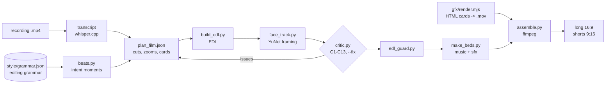

# video-pipeline

> Shorty 9:16: najpierw `style/ZASADY-KAMILA-SHORTY.md` (uwagi Kamila, błędy już raz zgłoszone).

**One talking-head recording in, an edited long video (16:9) and a set of vertical shorts (9:16) out.**
A local, scriptable editing pipeline: transcript, edit plan, EDL, face-aware framing, motion cards, music beds and an
ffmpeg render, with an automatic critic between every step. The browser editor that sits on top of it lives in its own
repository: [kamiljan11/video-pipeline-panel](https://github.com/kamiljan11/video-pipeline-panel).

Built for the author's own channel. Code under the [MIT licence](LICENSE); the author's photo (`gfx/test_kw.jpg`), name and
brand are not part of that grant.



## What it does

| Stage | Script | Notes |
|---|---|---|
| Transcript | `chunked_whisper.py` | whisper.cpp large-v3 (q5), word timings; `transcribe.py` = faster-whisper fallback |
| Edit moments | `beats.py`, `beatfx.py` | hooks, numbers, contrasts, punchlines, lists, questions -> zooms, cards, cuts, by the rules in `style/grammar.json` |
| Edit decision list | `build_edl.py`, `edges.py` | cuts on word boundaries, dead-air trimming, cut-edge repair (`edge_fix`) |
| Framing | `face_track.py`, `head_check.py` | face tracking for 16:9 and 9:16 crops, zoom limits that keep the head in frame |
| Critic | `critic.py` | 13 checks: static stretches, overlay collisions, hook timing, choppy shots, caption length, end screen, loudness (-14 LUFS), clipped speech, unverified numbers on screen, editing grammar, b-roll, dead air and loud cuts at edges; `--fix` rewrites the plan |
| Safety | `edl_guard.py` | an EDL may carry only numbers, local paths and allow-listed filters into ffmpeg ([ADR-0006](docs/adr/0006-edl-guard.md)) |
| Motion cards | `gfx/render.mjs` | HTML/CSS cards (keywords, numbers, maxims, web pages, lists, explainer scenes with a camera) rendered by Chrome to ProRes 4444 with alpha; pages at once = free cores / 4, 1-6 (`gfx/pace_lib.mjs`; `GFX_PAGES=<n>` overrides, 1-16), a slow screenshot waits 30 / 90 / 240 s before the card fails (night 2026-11-10: 6 pages under another job's load timed out on every try) |
| Text behind the speaker | `behind.py` | RobustVideoMatting matte, the card sits between the background and the person ([ADR-0005](docs/adr/0005-text-behind-speaker.md)) |
| B-roll | `broll.py`, `stock.py` | free Pexels clips where the speech names a concrete thing; credits for the description |
| Music | `music/make_beds.py` | generated beds and SFX, ducked under the voice |
| Render | `assemble.py`, `run_v4.sh` | segment cache, grading, captions for shorts, final mix; `--proxy` for 360p previews |
| Title check | `title_check.py` (`film_check` out.titles) | each A/B/C title in `out/youtube/long.md`: <= 60 characters, a word of `## Fraza kluczowa` in its first 3 words, a filled `źródło` column, and >= 2 of its content words heard in the long's first 30 s (words through the EDL); WARN (lists in `style/title_lint.json`, each with its `_evidence`) on no promise marker (kurs, od podstaw, tutorial count as delivery), "Mój" without a result or an outcome verb, a meta event title (vlog, Q&A, live), > 1 title ending in `?`, < 35 characters, a series prefix ("Odcinek 3:") or a brand tag after `\|` (creator study round 2) |
| Thumb check | `thumb_check.py` (`film_check` out.thumbs_read) + `gfx/thumbs.mjs` | at 320 px (a phone feed) OCR reads >= 80% of each long `big`, one variant without a face (YuNet), < 50% of a thumbnail's words in any title (words of `## Fraza kluczowa` not counted), big + sub + tag <= 5 content words (FAIL > 5, WARN > 4); WARN on a face under 40% of the frame height, a centred face, 2+ faces, flat tone or 0 / 4+ colour groups, a `big` that is a bare topic label (tool names are not, long and shorts), a small first letter or a sum of money; thumbs.mjs refuses letters under 12 px at 320, words in the bottom-right 12% (timestamp) and cover text outside y 220-1500 |
| Description check | `desc_check.py` (`film_check` out.youtube), `utm.py`, `style/platform_limits.json` | the long's `## Opis`: a `Rozdziały:` block from 0:00 inside it (YouTube reads chapters only there), tags <= 500 characters, hashtags under the limit; WARN on line 1 > 110 characters, the first link below line 2, KamilJan.com links without `utm_`, the `style/brand.json` footer missing, part 1 after 90 s, > 0.6 chapters/min, no `## End screen` naming a video or playlist, an empty pinned comment. Each short: a link to the long (`{{LONG_URL}}` until `desc_check.py --fill-long <url> out`), no template leftovers; WARN on > 3 lines or > 50 words before the link, a copy of the title, #shorts, > 2 hashtags, no `## Powiązany film` (creator study round 2, 16 longs, 32 shorts). Long and shorts: a number the film never says fails (round 2 X3, the same rule as posts, Instagram and the article; chapter rows, list markers, hashtags and lines with an outside source link do not count) |
| Hook check | `hook_check.py` (`film_check` short.hook_lint, out.hooks), `style/hook_lint.json`, `style/hook_bank.json` | the 6 hook killers on a short's hook (greeting, list title, filler start, vague promise or hype, no stake, not on screen from frame one) and <= 12 words; every short that is made has >= 3 clean variants in clips.json `hooks`, `hook` among them, `hook_from` a bank row. `result` = the short's views / the channel's 28-day median views, written by hand from YouTube Studio in the weekly review (ADR-0016), null until then |
| Count check | `count_check.py` (`film_check` long/short.counts) | the count he says (digits or Polish words, any case) from 3 s before to 4 s into a card equals its list items / largest group of scene elements, and every small number the card shows is said |
| Render audit | `render_audit.py` | the finished film against its EDL: flashes < 0.5 s, picture changes the EDL does not explain (card fades allowed), a word doubled by a cut, cards < 1.5 s, a non-full card hiding the face (YuNet); rc 1 with each item and time -> `<film>.audit.json` |
| Viewer review | `viewer_pack.py`, `review/viewer.md` | frame sheets + what is said + what is on screen, for an agent acting as a first-time viewer |
| Bare face | `film_check.py` (`face_full`, checklist `long.face_full <= 0.35`, level warn) | share of the long with no EDL overlay (card, float, sticker, scene, lower, chap, end) and no b-roll on the face; the 0.35 comes from the course author study (n=1), to be revised after the wider creator study |
| Research gate | `research_gate.py`, rejestr `creator-study/round2/ledger.jsonl` (ADR-0019) | no render while a research item of the form is `todo`, or `done` without a `check:<id>` that measures it; after `film_check --json`, `--report fc.json` needs every done item's check OK (a row for every film of its format; WARN, FAIL or no row = not met, SKIP = INFO with the plan's reason); `run_v4.sh` step `research_used` |
| Out gate | `out_gate.py <work> <out>` (ADR-0019) | the last step before Kamil watches an out folder: `film_check --out` without FAIL and every done `out.*` research item met; writes `<work>/fc_out.json`; an empty or broken report = exit 2 |
| Frame pick | `frame_pick.py`, `models/face_landmarker.task` (ADR-0020) | thumbnail and cover frames: every 0.1 s of a window scored on the face (YuNet: sharp, eye-box contrast, closed or smiling mouth, still; MediaPipe Face Landmarker: gaze, half-shut lids, pursed or rolled-in lips, open jaw, head yaw/pitch/roll). A glance aside, eyes down, a turned or tilted head and an odd mouth are no candidates; the rest ranked against the window's 90th percentile; `--sheet` = the top 6 to look at before a frame is used. Needs mediapipe: `python3 -m venv --system-site-packages ~/.local/share/vp-face-venv && ~/.local/share/vp-face-venv/bin/pip install mediapipe==1.2.2`, model from `https://storage.googleapis.com/mediapipe-models/face_landmarker/face_landmarker/float16/1/face_landmarker.task` into `models/`; run frame_pick and every script that imports it (the film's `work/build_pack_v3.py`, which picks the thumbnail and cover frames) with that python; `frame_pick` checks the model's sha256 (`LANDMARK_SHA`) |
| Checklist gate | `film_check.py`, `style/checklist.json` | every feature a long, a short and the out folder must have (chapters, explainer scenes, lower third, new music, A/B thumbnails, posts...); an item is met or skipped with a reason in the plan, else the film does not render ([ADR-0011](docs/adr/0011-editorial-team.md)) |
| Scene and retake gates | `film_check.py` (`long/short.scenes`, `long.retakes`), `gfx/scene_check.mjs` | a scene `scene_check.mjs` rejects fails the film (no skip; node missing or silent = FAIL with a reason); 4+ words said twice within 20 s stay only with `retakes_ok` {whole phrase: why}; shorts outside `short.length_min/max` fail ([ADR-0024](docs/adr/0024-role-flaws-become-gates.md)) |
| Picture gates before the render | `gfx/scene_check.mjs`, `build_edl.py` (`gfx_events.overlap_problems`) | words the camera carries under the face window, a "float" piece under 64 px (48 on 9:16), two side-box or full-screen cards on screen together for more than 0.5 s (plan `overlap_ok` {"id+id": why} names a pair meant to overlap): all three were found by watching the 2026-11-15 long |
| A long keeps what was said | `cuts.py` in `build_edl.py`, `retime_cards.py` | a long cuts only named mistakes (plan `cuts` {"w<a>-<b>": "retake/false start/slip/mic/Kamil date: why"}), pauses up to 0.7 s stay whole (Kamil 2026-11-15: 26 min cut to 18, "za ostro pociachane"); `retime_cards.py old_edl new_edl gfx_specs.json` moves every scene and float piece onto the new cut |
| Sound checks once per sound | `sound_seen.py`, `run_v4.sh` | sync, words, retake and music checks are skipped when the decoded sound, the cut, the words and the commit are the ones a dry run already passed (`sound_seen_<film>.json`); av_check and lip_check always run. Measured 2026-11-15: 78 of the long's 123 min were checks |
| Stills before render | `stills.py`, `gfx/render.mjs --stills` | every card of a film as a still on the real frame under it, with the sentence said, one sheet in < 60 s (film 2 long: 93 cards in 57.7 s); Kamil looks at the 2 key cards (`--only`), then the sheet, then `stills.py accept <plan> <id>…`; a card of a film with a sheet (`gfx/stills/scope.json`) does not render without an accepted still; `film_check` long/short.stills asks for the sheet ([ADR-0018](docs/adr/0018-stills-before-render.md)) |
| Scene check | `gfx/scene_check.mjs` | every explainer scene laid out in Chrome on its real camera before any frame is rendered (constants at the top of the file, why in `style/NOTES_LOG.md`): pieces covering each other or a stamp on words; rings around whole lines and lines ending <= 40 px from a piece (NOTES_LOG 18); text >= 40 px on the 1440 frame (9:16: 30 px) after the camera scale for its first 1.5 s (`MIN_TEXT_PX`, `READ_S`, NOTES_LOG 15); every piece of words up >= 0.6 s + 0.25 s a word, at least 1.2 s (`READ_MIN_S`, same rule as `screen_grammar.piece_need`, NOTES_LOG 4); no line cut by the frame or a board edge while the camera rests; no piece hidden for the whole card or faded out within 1.5 s of coming in (NOTES_LOG 18). Fix = move or enlarge the piece in the spec, fewer pieces, or a short's scene in one column; thresholds change in the file with a NOTES_LOG row |
| Thumbnails | `gfx/thumbs.mjs` | YouTube A/B/C thumbnails for the long and a cover per short from `thumbs.json`; stops when a word does not fit. Opt-in per variant: `tone: "lift"`, `accent: "thumb"` (theme token `--acc-thumb`), `layout: "object"` with `object` (1-2, >= 40% H or 45% W) or `panel` (3-5 steps/bars), one `arrow`; `python3 thumb_check.py --place thumbs.json` writes `fx`/`fy` so the face sits at x 0.72 / 0.28 |
| LinkedIn post graphic | `gfx/post_gfx.mjs`, `post_check.py` | a 1080x1350 graphic that carries the post's idea alone (list, bars, split, table or quote from `grafika.json`); OCR finds its words, WCAG contrast, and the text has >= 20 words (WARN outside 60-130), <= 3 hashtags (WARN above 0), <= 1 link (KamilJan.com with `utm_`), ends on a question for the comments ("P.S. …?" counts), a `cta_variant` (WARN without), `publish_day` per post in posts.json (one a day), no phrase from `style/voice.md` "## Zakazane", every number of the text and graphic said in the film (FAIL), a counted hook equal to the list items; WARN on line 1 with a greeting/filler, > 140 characters or a `?` ([ADR-0015](docs/adr/0015-blog-article-and-post-voice.md)) |
| Instagram carousel | `ig_carousel.py`, `gfx/carousel_gfx.mjs`, `style/brand.json` "instagram_hashtags" | `python3 ig_carousel.py --posts <work>/posts.json --posts-dir <out>/posts --out <out>/instagram [--only id] [--regen] [--no-render]`: per post with `make: true`, `carousel.json` (data: hook, 3-8 ideas, call; derived once from `linkedin.json`, a hand edit is kept, `--regen` derives again), `caption.json` (the post with "link w bio", tags, one alt text per slide) and `slide_NN.png` 1080x1350 + `slide_NN.txt` (the LinkedIn graphic's theme, font and CSP; the largest text size that fits, checked in the browser; the page counter is dots, never digits). The hook slide is the post's first paragraph, an idea slide one or two sentences of the body, the call slide the closing question + the ONE call "Napisz w komentarzu" (+ "link w bio" only when the post has a link); no word of its own except the call line, the swipe hint and that bio line; a hand-edited `carousel.json` is checked against the same rules (hook <= 160 characters, ideas <= 260, idea count from `style/platform_limits.json` slides_ok) before `caption.json` is written, so `ig_check --words` still holds every number against the film. A hook that promises N things gets exactly N idea slides |
| Instagram check | `ig_check.py`, `style/platform_limits.json` "instagram" | `<out>/instagram`: one carousel per post (`slide_NN.png` 1080x1350 numbered without gaps, `caption.json` {text, hashtags, alt[]}) and `reels/<short>.json` (the short's caption as a Reel). FAIL only on platform limits and honest numbers: > 5 hashtags, caption > 2200 characters, > 20 slides, alt not one per slide, a number the film never says (`--words`), a counted line 1 against the content slides, a Reel without line 1. WARN on line 1 > 125 characters, hook killers or `?`, > 3 hashtags, slides outside 5-10, a link in a caption (not clickable: "link w bio"), the last slide without exactly one call (SYNTH2-instagram R1-R6, R12; thresholds move after our own Insights) |
| Blog article | `article_check.py`, `publish_post.py` | a detailed PL + EN article for kamiljan.com from the film (`out/blog/<slug>/article.json`, sources beyond the film, the film linked before the first h2 and in the ending, numbers said or sourced, a lead <= 80 words with a digit, a recap list and one closing question; a how-to (lead promises N steps) needs 1500 words and N "Krok N" h2, else 1200 and 3); `publish_post.py --confirm` opens a PR on `kamiljan11/comfy-container`, the merge is Kamil's (needs a clone in `~/src/comfy-container` or `--repo`, `gh` on PATH, `GITHUB_Token` from the Infisical bridge) ([ADR-0015](docs/adr/0015-blog-article-and-post-voice.md)) |
| Screen grammar | `screen_grammar.py` | memes with `sticker` crops (`style/memes.json`) go beside the speaker as stickers, simple scenes in the free field (`layout: "side"`), cards held to their reading time, close separate screens joined ([REF-long-negacz](style/REF-long-negacz.md)) |
| Capability map | `capabilities.py`, `style/capabilities.json`, `design_ledger.py` (ADR-0023) | every card type, card/scene spec option (`sp.<key>`), scene piece, background, entrance, plan key and menu (memes, toons, music palettes and moods, card sounds, part-card styles, motion sets) found in the code has an owner role, a check and a use per form (required / report / infra / never / menu; `required` needs evidence: a why or a checklist item of that form); a film uses each required one or skips it with a reason (film_check long/short.capabilities); every `## Order of work` item of a design is a research ledger row, so research_gate blocks the render while it is open |
| Editorial team | `team/RUNBOOK.md`, `team/roles/` | the 12 steps of an edit, one role card each (mission, input, output file, when done) |
| LinkedIn post | `linkedin.py`, `gfx/carousel.mjs`, `deploy/` | text + PDF carousel, image or video (a short) + first comment, published on Kamil's profile through the official API after his OK, now or from a queue on a timer ([ADR-0009](docs/adr/0009-linkedin-document-posts.md), [ADR-0027](docs/adr/0027-linkedin-image-video-queue.md), section below) |

The editing style is data, not code: `style/grammar.json` (rules per format), `style/RESEARCH.md` (sources and lessons
from real reviews), `style/themes/` (brand colours). Decisions are recorded as ADRs in [`docs/adr/`](docs/adr/); terms
(plan, EDL, moment, critic codes, plan keys) are defined in the panel's [glossary](https://github.com/kamiljan11/video-pipeline-panel/blob/main/docs/GLOSSARY.md). Terms of this repo (card vs role card, scene, gate, checklist, palette): [`docs/GLOSSARY.md`](docs/GLOSSARY.md).

## Plan keys (sound, picture, framing)

The full table of plan keys lives in the panel repo: [README › Klucze planu](https://github.com/kamiljan11/video-pipeline-panel/blob/main/README.md).
The keys below change how the film sounds and looks; `build_edl.py` checks them when it reads the plan and `edl_guard.py`
checks the EDL again before ffmpeg runs. A bad value stops the build with the key named.

| Key | Values | Effect |
|---|---|---|
| `progress` | `"fill"`, `true`, `false` | `"fill"`: a bar at the bottom that grows with the film time. `true`: the old `drawbox` bar, which stands full width from the first frame; kept so old EDLs render the same |
| `music_duck` | `{"threshold": 0.001..1, "ratio": 1..20}` | how far the music dips under the voice (`sidechaincompress`). Default 0.015 / 6 nearly hides music under speech; 0.05 / 2.5 keeps it audible |
| `sfx_duck` | `{"threshold": 0.001..1, "ratio": 1..20}` | how far the sound effects dip under the voice, as `music_duck`. Default 0.015 / 6 (since 2026-11-09: a chapter riser covered a sentence); `{"ratio": 1}` = the old full-level SFX |
| `music_db`, `sfx_db` | dB | music and sound-effect level |
| `audio` | ffmpeg filter chain for the voice | replaces the default voice chain; only filters on the `AUDIO` list in `edl_guard.py` |
| `grade` | ffmpeg filter chain for the picture | replaces the default colour grade; only filters on the `VIDEO` list (`hqdn3d` included, against sensor grain in 9:16 crops) |
| `pads` | `{"pre", "post", "keep_l", "keep_r", "mingap"}`, seconds 0..2, each optional | more air at cuts. `pre`/`post`: sound kept before the first and after the last word of a keep (default 0.10 / 0.16); `keep_l`/`keep_r`: pause left after / before speech when a long pause inside a keep is shortened (0.15 / 0.12); `mingap`: only pauses longer than this are shortened (0.45); `keep_l + keep_r` must stay below `mingap`, or two pieces would overlap and play the same sound twice. Absent = the defaults, old plans cut as before |
| `music_palette` | `{"name": "lofi"\|"drive"\|"cinematic"\|"tech"\|"bright", "key": -6..6}` | another piece of music per film (`gen_music.py --palette --key`); `make_beds.py` writes it to `render/music_ledger.json` and `film_check.py` refuses the palette and key of the last other project. Absent = the old bed |
| `master` | `{"lufs": -14, "tp": -1.5}` (-24..-9, -3..-0.5) | after the render `assemble.py` runs `master_audio.py` on the whole mix: measured gain to the target (one correction pass), 4x oversampled limiter, 16 kHz low-pass before AAC; report `<film>.master.json`, off target = FAILED and the unmastered file kept. Absent = as before (film 2 long: -14.6 LUFS, true peak +1.9) |
| `gfx_lead` | seconds, -0.5..-0.1 (e.g. `-0.12`) | every overlay enters this much before its word (`build_edl.py`); a per-graphic `lead` wins; `film_check` gates `long/short.gfx_lead`. Absent = 0, as old EDLs |
| `skip` | `{"<checklist item id>": "why"}` | `film_check.py` lets the item pass and prints the reason in its report; an item without a reason stops the render |
| `face_target_y` | 0.3..0.6, vertical films only | height of the face centre in a zoomed 9:16 crop (default 0.40). Set it close to where the face sits in the recording (about 0.48 for a seated talking head), or the head jumps between zoomed and unzoomed shots. A 16:9 plan ignores it with a warning. Changing it re-cuts the segments on the next render |
| `punch_headroom` | `"hair"` (default) \| `"face"` | what a zoom keeps in frame (`face_track.py`): the whole head with its hair, or brow to chin. `"face"` lets a punch-in cut the top of the head; use it when the speaker sits close and the head fills the frame (film 2026-11-04: 0.61 punch-ins a minute with `"hair"`, 2.06 with `"face"`, ADR-0012) |

## Render order of a film (ADR-0025)

One long = one dry run + one full render, on code that does not change in between.

| step | command | what it gives |
|---|---|---|
| 1. dry run | `DRY=1 bash run_v4.sh <work> <out> long` | the film at 640 px with its full sound, every check after the render (`av_check`, `sync_check`, `lip_check`, `words_check`); writes `<work>/dry_long.json`, nothing goes to `<out>` |
| 2. full render | `bash run_v4.sh <work> <out> long` | refuses (`FAILED dry_run`) without a passed dry run of this film on this commit, this `edl_long.json` and this `gfx_specs.json` |
| 3. cut edges by hand | `python3 kden_export.py <work>/edl_long.json <x>.kdenlive --music … --sfx …`, Kamil drags edges with the Ripple tool and saves, `python3 kden_import.py <x>.kdenlive <work>/plan_long.json` | moved edges land in the plan as `cut_fix` (`[[old, new], …]` seconds in the recording); an edge that brings back or cuts a whole word stops `build_edl.py` and names the words to add to / take out of `keeps` |
| 4. acceptance | `python3 accept.py write <work> <out>/long/long.mp4 "Kamil YYYY-MM-DD: <his sentence>"` | any film other than the long (`run_v4.sh … s01`) waits for it; a long cut or rendered again needs a new one |
| watch a run | `python3 watch_render.py render/render.log <work>/timeline.log <work>/gfx.log render/long` | one line at the end: `DONE …` (exit 0), `FAILED …` (1), `STALL …` (3, nothing changed for `--stall` seconds, default 900) |

- A gate switched off (`LIP_CHECK=off`, `WORDS_CHECK=off`, `FILM_CHECK=off`, `SCENE_CHECK=off`, `RESEARCH_GATE=off`) renders nothing unless the plan has `"waivers": {"lip_check": "Kamil YYYY-MM-DD: <his sentence>"}`; every `render.log` run starts with `SKIPPED_GATES: …`.
- `<work>/timeline.log`: when each stage of each film started (`run`, `scene_check`, `gfx`, `plan`, `beds`, `behind`, `assemble`, `checks`, `end`).

## Quick start (Ubuntu)

Linux x86_64 only (developed on Ubuntu 26.04, CI on 24.04). Clone it anywhere whose path has no spaces: every script finds
the checkout from its own location. Chrome is expected at `/usr/bin/google-chrome` (where Google's `.deb` puts it).
Nothing below needs your accounts; publishing to LinkedIn or YouTube is a separate, opt-in step.

```bash
git clone https://github.com/kamiljan11/video-pipeline && cd video-pipeline
sudo apt install git curl cmake build-essential poppler-utils python3.12-venv tesseract-ocr tesseract-ocr-pol   # + Node 24 (nodejs.org), Google Chrome
bash install/ffmpeg.sh                  # ffmpeg 8 into ~/.local/bin, sha256-checked (Ubuntu 24.04 apt has 6.1, too old)
mkdir -p ~/.local/share/fonts && cp fonts/Montserrat-VF.ttf ~/.local/share/fonts/ && fc-cache -f   # captions find the font by name
npm ci
python3.12 -m venv .venv && .venv/bin/pip install -r requirements.txt
# whisper.cpp: build it in ./whisper.cpp ("Postawienie od zera", step 4)
bash install/fetch_models.sh            # whisper model, YuNet, face landmarker into models/, each sha256-checked
bash install/check.sh                   # one line per requirement: ok or MISSING with the fix
bash run_v4.sh <project>/work <project>/out long short1
```

A git worktree is a checkout of its own: give it `node_modules` (`npm ci`, or `ln -s <main checkout>/node_modules`), and
`.venv` and `models/` the same way, before it renders.

A project directory holds the recording, `words.json` (transcript), `plan_<film>.json` and `gfx_specs.json`; renders
and caches go to `render/` (ignored by git). Recordings, transcripts and renders are never committed.

A full render (a long with ~100 cards) peaks at tens of GB. Run it in its own memory-capped unit, so a blow-up kills
the render and not the desktop session or the terminal it was started from:

```bash
systemd-run --user --unit=vp-render --collect -p MemoryMax=60G -p MemorySwapMax=0 --setenv=PATH="$PATH" \
  bash run_v4.sh <project>/work <project>/out long
```

`assemble.py` writes the exact stage-2 picture command to `<out>/assemble.args.json` (the sound mix and the mux go to
`assemble.audio.args.json`: they run separately, see av_check.py), so a killed render can be rerun
and measured by hand (`/usr/bin/time -v ffmpeg ...`). Why the card inputs carry `CARD_IN`: comment in `assemble.py`.

## Install with Claude Code

The pipeline is a Linux tool (developed on Ubuntu 26.04). Nobody has installed it on another machine yet, so expect a
few fixes. The quickest route is to let an AI coding agent do the setup on your machine: open
[Claude Code](https://claude.com/claude-code) in an empty directory and paste the prompt below. On Windows, run it
inside WSL2 (Ubuntu); native Windows is not supported.

```text
Install the video pipeline from https://github.com/kamiljan11/video-pipeline on this Linux machine and make it run
from where you clone it.

1. Read README.md first: "Quick start", "Postawienie od zera (Ubuntu)" (Polish, the full setup) and the table of
   scripts. requirements.txt and package-lock.json pin the versions; install exactly those.
2. Clone it to a path without spaces; the scripts find the checkout themselves, do not edit paths in them.
   Chrome is expected at /usr/bin/google-chrome.
3. Follow "Quick start" in order: apt packages, Node 24, Google Chrome, `bash install/ffmpeg.sh` (ffmpeg 8 into
   ~/.local/bin; Ubuntu 24.04 apt has 6.1, too old), the font, `npm ci`, `.venv`, whisper.cpp at the commit named in
   "Postawienie od zera", `bash install/fetch_models.sh`, ruff (`pipx install ruff==0.16.10`, the version CI uses).
   Show me each command that needs sudo before running it. `bash install/check.sh` must end with "ready".
4. Run the tests (`npm test`, `.venv/bin/python -m unittest discover -s tests`, `ruff check .`) and fix only what
   blocks them on this machine. Tell me what you changed.
5. B-roll needs a free Pexels API key in the environment variable `PEXELS_API_KEY` (`stock.py`); ask me for it, never
   write it into a file in the repo.
6. Then take my recording <path to my .mp4>: transcribe it, propose plan_long.json (cuts, zooms, cards) and one short,
   show me the plan before rendering, render a 360p proxy (`--proxy`), and only after my OK the full render.
```

## Tests

```bash
npm test                                              # cards (node --test; needs Chrome)
.venv/bin/python -m unittest discover -s tests
ruff check .
```

The larger suite (compatibility of every script with its pre-panel baseline, live player, HTTP API) is in the
[video-pipeline-panel](https://github.com/kamiljan11/video-pipeline-panel) repository; it expects this repo as its parent directory.

---

## Dokumentacja (PL)

Operational notes below are in Polish, the working language of the project.

Skrypty montażu nagrań (talking head -> long 16:9 + shorty 9:16). Repo gita, publiczne na GitHubie od 2026-10-24 (ADR: `docs/adr/0007-*`, wcześniej `docs/adr/0001-*`, karta `web`: `docs/adr/0002-*`).

| Krok | Skrypt | Uruchamia |
|---|---|---|
| wygładzenie (szarpanie) | `dejudder.py <nagranie.mp4> <work>/<nagranie>.dejudder.mp4` (`.venv`): klatki, których kamera nie dała (ffmpeg je powtórzył), zastępuje klatką pośrednią z przepływu optycznego; czas i dźwięk bez zmian, więc plan i transkrypcja pasują; `--scan` tylko liczy. Plan: `"src"` = plik `.dejudder.mp4`. Kiedy: nagrywarka pisze w powiadomieniu „Kamera nie nadążyła” albo log `camera frames … repeated` > 2 % | ręcznie / zadanie (przed EDL) |
| transkrypcja | `chunked_whisper.py` (whisper.cpp; `transcribe.py` = to samo na faster-whisper, zapasowo) | ręcznie / zadanie |
| momenty montażu | `beats.py`, `beatfx.py` (reguły: `style/grammar.json`, źródła: `style/RESEARCH.md`) | panel „Rozpoznaj momenty” |
| b-roll stock | `broll.py` (dobór), `stock.py` (Pexels, klucz `Pexels` z Infisicala) | panel „Dobierz b-roll” |
| EDL | `build_edl.py` (krawędzie cięć: `edges.py`, klucz `edge_fix`; **nowy plan = `"edge_fix": {"dips": true}`**, opis: `panel/README.md` › Klucze planu) -> `face_track.py` | panel / `run_v4.sh` |
| krytyk | `critic.py` (C1–C13), `head_check.py` | panel / `run_v4.sh` |
| muzyka | `music/make_beds.py` | `run_v4.sh` |
| render | `edl_guard.py` (co EDL może wnieść do ffmpeg, ADR-0006; odmowa = `FAILED edl_guard <film>`), `assemble.py` (`--proxy` = podgląd), grafiki `gfx/render.mjs` | `run_v4.sh <work> <out> <filmy…>` |
| recenzent-widz | `viewer_pack.py <plan.json> <film.mp4> <katalog>` (`.venv`): arkusze klatek co 2,5 s (short 1,5 s) z czasem + co mówi + co na ekranie, okna 30 s (short 15 s) -> `pack.md`; `--zoom T0 T1` = jedno podejrzane miejsce klatka co 0,1 s (`zT0-T1.jpg`); agent czyta to wg `review/viewer.md` i zapisuje `findings.<film>.json` (gdzie widz odpadnie: nuda, pusta karta, niezgodność obrazu i słów). Uwagi nanosi człowiek albo sesja główna | po renderze, przed publikacją (sesja Claude Code) |

Panel montażowy i cała dokumentacja (README z obsługą błędów, kluczami planu i kontraktami skryptów, słownik, ADR gramatyki
montażu i b-rollu, testy tych skryptów): `panel/` — osobne repo gita (tu ignorowane), zob. `panel/README.md`,
`panel/docs/GLOSSARY.md`, `panel/docs/adr/`.

Logi (`render/`): `render.log` (każdy krok, `DONE <film>` / `FAILED <krok> <film>` / `FAILED_FILMS`), `critic_<film>.log`,
`beat_stats.log` (metryka po renderze), `gfx.log` w katalogu `work` projektu.

**Bramki w `run_v4.sh` i co robić, gdy render stoi** (kolejność: scene_check -> gfx -> film po filmie: build_edl ... edl_guard ->
film_check -> make_beds -> behind -> film_check --phase behind -> assemble). Proces montażu krok po kroku: `team/RUNBOOK.md`.

| `render.log` | Gdzie przyczyna | Co zrobić |
|---|---|---|
| `FAILED scene_check` | `gfx.log`: linie `CLASH <scena>: <a> covers <b>` (exit 124 = Chrome zawisł, limit 600 s) | przesunąć element w specu sceny (`node gfx/scene_check.mjs gfx_specs.json <id>` sprawdza jedną). Fałszywy alarm: `SCENE_CHECK=off bash run_v4.sh …` (w logu zostaje `WARN scene_check off`) |
| `FAILED gfx <id>: no accepted still` | `gfx.log`; karta filmu z arkuszem (`gfx/stills/scope.json`), karta nowa albo zmieniona po akceptacji | `python3 $VP/stills.py plan_<film>.json --only <id>`, Kamil ogląda `gfx/stills/<id>_still.jpg`, potem `python3 $VP/stills.py accept plan_<film>.json <id>`. Pilne: `STILLS=off bash run_v4.sh …` (w logu `WARN stills gate off`) |
| `FAILED scene_check rc=124` | limit `SCENE_CHECK_TIMEOUT` (domyślnie 600 s) minął, Chrome zawisł | puścić jeszcze raz; zawisa stale = `node gfx/scene_check.mjs gfx_specs.json` ręcznie i patrzeć, na której scenie staje |
| `film_check: music ledger … ` (exit 2) | `render/music_ledger.json` (lokalny, poza gitem, pisze go `make_beds.py`) zepsuty | poprawić JSON ręcznie albo usunąć plik (traci się tylko pamięć palet poprzednich filmów; inna maszyna zaczyna z pustym) |
| `FAILED out` (exit 2, przed jakimkolwiek krokiem) | folder wyników nie istnieje albo nie ma prawa zapisu; względny OUT liczy się od folderu `work` (skrypt robi `cd` do niego) | podać ścieżkę bezwzględną albo `../out` względem `work` |
| `FAILED research_gate <forma> <film>` (przed filmem) | `render.log`: pozycje rejestru badań formy `todo` albo `done` bez `check:<id>` (ADR-0019) | wprowadzić pozycję do filmu i punktu `film_check`, albo `deferred` z `Kamil:`/`data:`, `rejected` z powodem w `ledger.jsonl`. Pilne: `RESEARCH_GATE=off bash run_v4.sh …` (w logu `RESEARCH_GATE=off: research_gate skipped`) |
| `FAILED research_used <forma> <film>` | `render/fc_<film>.json` (raport `film_check --json`) i linie `… done, but <check> is WARN/FAIL in <film>` albo `has no row for <film>` w `render.log` | poprawić plan filmu, aż punkt jest OK, albo `skip` z powodem w planie (raport pokaże INFO); exit 2 = raport pusty lub zepsuty (film_check padł: jego błąd jest wyżej w logu) |
| `out_gate.py` exit 1 / 2 (po materiałach, poza `run_v4.sh`) | `<work>/fc_out.json`, linie `FAIL …` i `… not met` na wyjściu | poprawić materiał w `out/` i puścić `python3 $VP/out_gate.py <work> <out>` jeszcze raz; exit 2 = `film_check --out` nie dał raportu albo przekroczył 3600 s |
| `FAILED lip_check <film>` | `render.log`: wiersze `<czas> s picture … sound … desync …` i `lips: … FAIL` (`lip_check.py`, ADR-0022) | głos odjechał od ust względem nagrania: mediana > 20 ms albo kawałek > 45 ms. Sprawdzić łańcuch `audio` planu (`python3 -c "import av_latency;print(av_latency.chain_ms('<łańcuch>'))"`) i start wideo nagrania (`ffprobe … stream=start_time`). „not measurable” przy zoomie na każdym kawałku = `LIP_CHECK=off bash run_v4.sh …` z powodem (zostaje wpis w logu) |
| `FAILED capabilities map <film>` / `FAILED design_ledger <film>` | `render.log`: `FAIL card.x: in the code, not in style/capabilities.json` albo `FAIL design:<plik>:<n>:<forma>` | nowa funkcja w kodzie bez wpisu (właściciel = karta roli, check, use) w `style/capabilities.json`; punkt designu bez wiersza w rejestrze = `python3 design_ledger.py sync`, potem `ledger.py set` (ADR-0023) Bez wyłącznika: `RESEARCH_GATE=off` tych dwóch nie pomija. Rejestr badań leży poza repo (`~/Dane/creator-study/round2/ledger.jsonl`, nocna kopia restic `mas-rescue-backup` na kartę SD); brak pliku = `FAIL research ledger … not readable`, odtworzenie z kopii (`restic restore`). |
| `FAILED film_check <film>` z `long.capabilities` / `short.capabilities` | `critic_<film>.log`: `required, not used and not skipped with a reason: …` | dodać funkcję do filmu albo `"skip": {"cap.<id>": "powód"}` w planie (jeden powód na funkcję: skip punktu listy jej nie zwalnia); `python3 capabilities.py map <work> <film>` pokazuje całą mapę |
| `FAILED gfx` | `gfx.log` | błąd specu karty albo Chrome; karta z tym samym kluczem (`<id>.mov.key`) nie renderuje się drugi raz |
| `FAILED film_check behind <film>` | `critic_<film>.log`: `long.behind_readable` z listą `hidden: <karta> <procent>` (`gfx/<id>.cover.json`) | karta za postacią jest zasłonięta w ponad 15%: przesunąć ją nad linię głowy albo zmniejszyć w planie i puścić ponownie. Miara zginęła (karta bez `cover.json`): `behind.py` zrobi ją sam przy następnym uruchomieniu. Świadomie zasłonięta: `"skip": {"long.behind_readable": "<powód>"}` |
| `FAILED film_check <film>` | `critic_<film>.log`: lista pozycji z `why` | dodać brakującą rzecz do planu albo `"skip": {"<id>": "powód"}` w planie. Stary projekt sprzed listy (przed 2026-11-04): `FILM_CHECK=off bash run_v4.sh …` (`WARN film_check off <film>`); nigdy po to, żeby film wyszedł szybciej |

Cache kart (`gfx/render.mjs`): klucz `<id>.mov.key` = motyw + specyfikacja karty (scena także źródło `gfx/scene_lib.mjs`). Po
zmianie specu karta renderuje się sama, nie trzeba kasować `.mov`. Projekty sprzed 2026-11-04 nie mają `.key`, więc przy
pierwszym renderze po tej zmianie wszystkie ich karty renderują się raz od nowa (dłuższy render, ten sam wygląd).

Jednorazowe skrypty projektu 2026-10-20 (`render_v3.sh`, `render_all.sh`, `check_long.sh`, `final_check.sh`) usunięte
2026-11-17: miały na sztywno katalog filmu autora; są w historii gita. Pomocnicze: `run_whisper.sh` (whisper.cpp bez dzielenia), `spot_check.py`, `verify_cut.py`,
`lines.py`, `to_otio.py` (eksport long do Kdenlive, woła go `run_v4.sh`), `stop_render.py`, `pdl.sh` (pobieranie równoległe),
`music/gen_music.py`. `PANEL_SPEC.md` / `PROMPT_PANEL.md` = historyczna specyfikacja panelu (aktualna: `panel/README.md`).

## Postawienie od zera (Ubuntu)
Skrypty znajdują katalog repo same (od 2026-11-17 bez ścieżki autora w kodzie): klonuj gdziekolwiek, byle bez spacji w ścieżce.
`bash install/check.sh` pokazuje, czego brakuje.
1. System: `ffmpeg` 8 lub nowszy (apt w Ubuntu 24.04 ma 6.1; `bash install/ffmpeg.sh` = build 8.x do `~/.local/bin`, sha256 sprawdzane), `python3` (systemowy: build_edl, critic, assemble, beats, beatfx, broll, stock), Node 24, Google Chrome w
   `/usr/bin/google-chrome` (plansze renderuje `playwright-core` na tym Chrome), `poppler-utils` (karty `web` z PDF). `.venv`: face_track, head_check, make_beds, to_otio.
2. `npm ci` (playwright-core, lucide-static, gsap z `package-lock.json`; gsap tylko dla kart `count`).
3. `python3.12 -m venv .venv && .venv/bin/pip install -r requirements.txt` (wersje przypięte, stan 2026-10-21).
4. whisper.cpp (w katalogu repo): `git clone https://github.com/ggml-org/whisper.cpp && git -C whisper.cpp checkout 231638a &&
   cmake -B whisper.cpp/build -S whisper.cpp && cmake --build whisper.cpp/build -j` (231638a = wersja używana od 2026-10; potrzebne
   `cmake` i `build-essential`).
5. Modele: `bash install/fetch_models.sh` pobiera do `models/` model whispera `ggml-large-v3-q5_0.bin` (Hugging Face
   ggerganov/whisper.cpp), detektor twarzy YuNet (opencv_zoo) i MediaPipe Face Landmarker; każdy plik zostaje tylko z sha256
   z `install/models.sha256` (sumy publikowane przez wydawców).
   Font kart i napisów: `fonts/Montserrat-VF.ttf` (Montserrat z google/fonts, licencja SIL OFL 1.1, `fonts/OFL.txt`); napisy
   (libass) szukają go po nazwie, więc skopiuj go do `~/.local/share/fonts` (Quick start).
6. B-roll: klucz API Pexels w zmiennej `PEXELS_API_KEY` (albo `Pexels`; u autora sekret `Pexels` w Infisicalu, most `~/infisical`);
   bez niego reszta pipeline'u działa.
7. Panel: `panel/` = osobne repo https://github.com/kamiljan11/video-pipeline-panel sklonowane do `panel/` (`panel/README.md`).
8. Lint/typy (globalnie, nie w `.venv`): `pipx install ruff==0.16.10` (wersja z CI), `npm i -g pyright`.
9. Tekst za postacią (tylko gdy plan ma karty `"behind"`): `python3 -m venv matte/.venv && matte/.venv/bin/pip install -r matte/requirements.txt`
   + model `matte/models/rvm_resnet50_fp32.onnx` z https://github.com/PeterL1n/RobustVideoMatting/releases/tag/v1.0.0
   (sha256 `25db300fcb6ee27f…`, `behind.py` sprawdza go przy każdym uruchomieniu; decyzja: ADR-0005).
10. Głos (tylko gdy plan ma `"voice_clean": "dfn"`): binarka DeepFilterNet 0.5.6, plik
   `deep-filter-0.5.6-x86_64-unknown-linux-musl` z https://github.com/Rikorose/DeepFilterNet/releases/tag/v0.5.6 do
   `~/.local/share/vp-voice/dfn/deep-filter` (albo ścieżka w zmiennej `VP_DEEP_FILTER`), `chmod +x`, sha256
   `70775e251eee44c0f2451a1e833326cf8bcbbe304d3e7cd12851e6fce72ef7da`. Bez niej render z tym kluczem kończy się błędem z nazwą
   ścieżki (`voice_clean.py`); decyzja i pomiary: ADR-0026.

Przed publikacją shorta z b-rollem: linie autorów do opisu filmu (wytyczne API Pexels) = okno „Dobierz b-roll” w panelu albo
`python3 broll.py plan_<film>.json --credits` w katalogu `work`.

Bramki: pre-commit (ruff, pyright, skan sekretów) działa przez globalne `core.hooksPath=~/.claude/git-hooks` laptopa, nie z repo;
na innej maszynie uruchamiaj `ruff check . && pyright` ręcznie.
**Kopia kodu i zasad stylu:** publiczne repo https://github.com/kamiljan11/video-pipeline (+ panel: kamiljan11/video-pipeline-panel),
od 2026-10-24 (ADR-0007). Nagrania, transkrypcje, plany i rendery NIE idą do gita (`.gitignore`): kopii poza laptopem nie mają.
**Dysk:** od 2026-10-24 `~/video-pipeline` i `~/Videos` to symlinki do `~/Dane/...` (dysk Dane, LUKS, montowany przy starcie z
`/etc/crypttab`); ścieżki w skryptach i planach się nie zmieniły. Panel kluczuje swoje katalogi po ścieżce rozwiązanej (`render/panel/*/<klucz>`).
**Po filmie (Kamil 2026-11-05):** gotowy film żyje w chmurze, więc stary projekt (`render/montaz/<data>`, `render/<film>`, karty,
cięcia) na laptopie nie zostaje: usuwamy go, gdy Kamil potwierdzi, że film jest w chmurze. Film w toku sprzątamy w całości po
akceptacji, nigdy po kawałku: spis kart w EDL to nie wszystkie używane pliki (`behind.py` czyta `<id>.front.mov`, którego żaden EDL
nie wymienia). Jeden film zostawia ok. 50-60 GB pamięci podręcznej, a Dane ma 196 GB: przed dużym renderem `df -h ~/Dane`.
**Miniatury A/B:** każdy film dostaje co najmniej 2 warianty miniatury longa i okładkę każdego shorta; pilnuje tego
`film_check.py --out` (punkt `out.thumbs` w `style/checklist.json`).

Testy skryptów: `cd panel && .venv/bin/python -m unittest discover -s tests` (strażnik zgodności: bez nowych kluczy planu
wynik identyczny jak `panel/tests/pipeline_baseline/*.py.orig`). Lint: `ruff check .`, `pyright` (pre-commit).
Testy `dejudder.py` i `viewer_pack.py`: `.venv/bin/python -m unittest tests.test_dejudder tests.test_viewer_pack`.
Testy kart `web` i `count` (JS, bez internetu; `count` renderuje w Chrome): `npm test`; uruchamia je też zestaw panelu (`panel/tests/test_gfx_node.py`).

Dodanie dostawcy stocku: funkcja wyszukiwania w `stock.PROVIDERS` + host plików w `stock.HOSTS` + klucz w Infisicalu
(most `~/infisical/infisical_bridge.py run --secrets <NAZWA> --`), potem `"provider"` w `style/grammar.json › broll`.

## Karta źródła `web` (strona albo PDF, o którym mówisz)
Dlaczego zrzut z animacją, a nie nagranie ekranu, i jak chroniona jest sieć: `docs/adr/0002-web-source-card.md`.
Gdy w nagraniu przytaczasz badanie, artykuł albo stronę, pokaż ją: karta = okno przeglądarki ze stroną, przewija się do
cytowanego zdania i zaznacza je markerem; twarz w rogu (jak `slide`), pod spodem „Źródło: domena · tytuł · stan na <data zrzutu>”.
Wpis w `gfx_specs.json` (kotwica w planie jak każda grafika, `"gfx": [{"id": "w_mit", "word": 512}]`):
```json
{"id": "w_mit", "type": "web", "dur": 7, "url": "https://…", "find": "dokładne zdanie ze strony (min. 8 liter)"}
```
- PDF: ten sam wpis (adres PDF); opcjonalnie `"page": 3`, gdy zdanie występuje na kilku stronach. Podpis własny: `"src"`.
- Strona blokuje roboty (captcha, logowanie, paywall): zrób zrzut sam, połóż w katalogu `work` projektu i daj
  `{"id": …, "type": "web", "dur": 7, "img": "zrzut.png", "box": [x, y, szer, wys], "url": "…", "title": "…"}` (`box` w pikselach zrzutu).
  Blokad nie obchodzimy. W panelu: pole „własny zrzut” w edytorze grafiki (`box` tylko w pliku).
- Zrzut robi `gfx/webshot.mjs` (woła go `gfx/render.mjs` sam): Chrome 1200 px szerokości, tylko `https://` i tylko publiczne
  adresy: każde połączenie (też przekierowania, skrypty i obrazki strony) jest sprawdzane PO rozwiązaniu nazwy przez
  `gfx/netguard.mjs` (Chrome idzie przez jego lokalny proxy), więc nazwa wskazująca na `127.0.0.1`, sieć domową (też publiczny prefiks IPv6 laptopa) albo Tailscale
  (np. `127.0.0.1.nip.io`) jest odrzucana; `file://` też. Chrome ze stroną działa w piaskownicy. `img` = sama nazwa pliku. Banery cookies są ukrywane, nigdy klikane. Zrzut jest robiony raz:
  `work/gfx/web/<klucz>.png/.json` (klucz = `url`, `find`, `page`, `img` z treścią pliku, `box`, `title`); zmiana któregoś
  z nich = nowy zrzut i nowy `.mov` karty. Ten sam adres od nowa (strona się zmieniła): usuń te dwa pliki.
- Błąd (zdania nie ma na stronie, HTTP 4xx/5xx, adres prywatny, > 150 s na kartę) = `FAILED webshot <id>: powód` w `gfx.log`
  (render z `run_v4.sh`) albo w wyniku zadania w panelu (podgląd), i film się nie renderuje (`FAILED gfx`). Nieudany zrzut nie
  zostaje w pamięci: po poprawce wystarczy uruchomić ponownie.
- **Short (9:16): `"canvas": "v"`**, wzorzec z rozbioru `style/REF-shorts-proof-cards.md`; uwagi Kamila, których nie wolno powtórzyć: `style/ZASADY-KAMILA-SHORTY.md` (czytać przed montażem shortów). Klucze karty 9:16: `face_box` [x, y, w, h] + `caption_y` + `face_anchor` (boks pod krótką kartą), `face_corner` (kółko z twarzą przy pełnej karcie), `no_fade_out` / `no_fade_in` (karty stykające się bez zanikania), `logo_h` (wysokość logo na karcie końcowej). Karta pokazuje stronę powiększoną na cytacie
  (okno ≥ 40 % szerokości zrzutu, cytat + 5 % z boków; `gfx/webshot_lib.mjs` › `vZoom`), żeby tekst dało się przeczytać na telefonie.
  Zrzut 9:16 robiony w szerokości telefonu (430×932 CSS px @3x, `VIEW_V`): strona ma jedną kolumnę, więc okno to ≥ 90 % szerokości
  zrzutu (`V_MIN_WIN_PHONE`); własny klucz pamięci (zrzuty 16:9 bez zmian, klucz przypięty w teście). Warstwy zgód (cookie/CMP)
  ukrywane także po przewinięciu i w zwykłym przepływie strony (po id/klasie, nie po tekście). Bez PiP w rogu. `"layout"`:
  - `"split"` (domyślnie): jasne tło, karta u góry (y 110–992), twarz w boksie pod nią z zaokrąglonymi górnymi rogami
    (`gfx_types.SPLIT`: x 130, y 1240, 820×680, węższy niż karta, żeby zmieścić głowę z brodą; `assemble.py` wycina go z kadru mówcy; punkt
    w połowie między `face[1]` a `face_target_y` stoi na 58 % wysokości boksu, więc mieści się czubek głowy), napisy w szczelinie między kartą a boksem (`\pos(540,1150)`, `build_edl.py`). Boks znika 0,18 s przed
    końcem karty (w połowie jej wygaszania);
  - `"full"`: ciemne tło, sama karta (y 230–1132), napisy na swoim miejscu, bez twarzy.
  `layout` tylko na `web` z `canvas: "v"` (inaczej nazwany błąd w `build_edl.py` i `render.mjs`). Karta 9:16 nie może wejść pod
  `hook_text` (krytyk C2). Test: `tests/test_vertical_web.py`, `gfx/test/webshot.test.mjs`.
  ```json
  {"id": "w_mit", "type": "web", "canvas": "v", "dur": 4, "url": "https://…", "find": "dokładne zdanie"}
  ```
  Paywall, który rozmywa tekst (np. Fortune), przechodzi przez zrzut bez błędu i daje kartę z rozmytym tekstem: obejrzyj
  `gfx/web/<klucz>.png` przed renderem; wtedy inne źródło albo własny zrzut (`img`).
- `"read_along": [s, …]` (L16b, opcjonalnie): linia cytatu dostaje zaznaczenie w chwili, gdy ją czytasz (s od startu karty, po
  jednej na linię; brakujące idą co 0,25 s). Każda chwila po przewinięciu i 1,4 s przed końcem karty, inaczej nazwany błąd. Bez
  klucza: zaznaczenie po przewinięciu, linie co 0,25 s, jak dotąd (`webshot_lib.mjs` › `markTimes`).
- Prawo cytatu: krótki fragment z podanym źródłem; nie pokazuj całych artykułów zza paywalla.

## Karta licznika `count` (liczba odliczana od 0)
Decyzja i koszt: `docs/adr/0003-gsap-count-card.md`. Wygląd jak `kw` (ta sama ramka, `side`, `icon`, `canvas: "v"` + `compact`),
ale każda liczba z `text` odlicza od 0 do swojej wartości (GSAP, `gfx/count_lib.mjs`). Bez nowych pól:
```json
{"id": "c95", "type": "count", "text": "95%", "sub": "firm bez zwrotu z AI", "dur": 4}
```
- Liczy: „95%”, „2,5 dnia” (przecinek), „12 000 zł” (spacja tysięcy zostaje), „50–70%” (obie liczby), „-5%” (minus zostaje tekstem).
- Nie liczy (zostaje jak napisane): liczby w słowie albo kodzie („B2B”, „Q3”, „v2.0”), godziny („15:30”), liczby z kropką
  („10.5”), zera wiodące („007”). Panel odrzuca kartę `count`, w której nie ma żadnej liczby do odliczania.
- Odliczanie startuje po 0,35 s (gdy ramka już weszła) i trwa 40 % długości karty, maks. 1,6 s; kończy się przed wygaszeniem.
- `"from"` (S11, opcjonalnie): start odliczania zamiast 0, jedna liczba dla wszystkich albo lista, po jednej na liczbę w `text`
  (lista rośnie z 3 do 4 pozycji: `"text": "4 kroki", "from": 3`). Bez klucza: od 0, jak dotąd (`count_lib.mjs` › `countFrom`).
  Karta krótsza niż ok. 1 s pokazuje liczby od razu.
- Dźwięk „pop” jak `kw`; pod kartą 16:9 nie ma najazdu (`gfx_types.SIDE_BOX`).
- Wymaga `node_modules/gsap` (`npm ci`, krok 2 wyżej). Bez niego render kart kończy się `FAILED gfx` w `render.log`.

## Złota myśl `maxim` (zdanie pisane na ekranie)
Puenta, którą chcemy podkreślić: zdanie pisze się litera po literze z kursorem, w chwili gdy pada; słowa w `*gwiazdkach*`
dostają kolor akcentu i kreskę markera po napisaniu. 16:9: dolny pas z ciemnym gradientem (twarz zostaje widoczna, najazd
pod kartą działa); `canvas: "v"`: górny pas shortu. Logika: `gfx/maxim_lib.mjs`, test: `gfx/test/maxim.test.mjs`. Bez GSAP.
```json
{"id": "m01", "type": "maxim", "text": "Prawdziwy ból jest *cichy*", "dur": 5, "at": [0.2, 0.85, 2.6, 2.87],
 "sfx": [[3.0, "pop"]]}
```
- `at` (opcjonalne): start każdego słowa napisu w sekundach od startu karty, z transkrypcji (tyle liczb, ile słów; inaczej
  równe tempo po literach). Czas nigdy nie cofa się i nie wychodzi poza kartę: ostatnie słowo widać min. 0,3 s. Napis nie
  musi być dosłowny, ale każde jego słowo przypinamy do słowa, które wtedy pada.
- Litera pojawia się najwyżej co 0,045 s i słowo kończy się przed następnym; kursor gaśnie 0,7 s po ostatniej literze.
- Dźwięk: miękki whoosh na wejście (`make_beds.py`); własne chwile karty (np. pop na wyróżnieniu) w `sfx`.
- Kiedy: 1 zdanie-puenta (`maxim` w gramatyce), maks. ok. 1 na 3–4 min w long; nie razem z inną kartą.

## Scena `scene` (schemat na ciemnym płótnie, twarz w kółku)
Decyzja i koszt: `docs/adr/0010-scene-card.md`. Wzór: rozbiór filmu AI LABS z 2026-10-25 (16 min bez twarzy: płaskie ciemne
karty, szare kreski zamiast nieistotnego tekstu, kolor tylko tam, gdzie ma patrzeć oko, kamera, która przesuwa się między
elementami). U nas to samo, ale z twarzą: karta wypełnia ekran, a `assemble.py` kładzie twarz w kółku w prawym dolnym rogu
(`gfx_types.PIP`), jak przy `slide` i `web`. Logika: `gfx/scene_lib.mjs`, test: `gfx/test/scene.test.mjs`. Bez GSAP.
```json
{"id": "s_szlaban", "type": "scene", "dur": 9,
 "els": [
   {"k": "term", "id": "term", "x": 160, "y": 260, "w": 1640, "title": "Claude Code · bash", "cmd": "git push --force origin main",
    "out": ["[bash-guard:force-push] ZABLOKOWANE / BLOCKED (rule force-push)."], "hl": [0], "tone": "bad", "at": 0.5},
   {"k": "stamp", "id": "stamp", "x": 1180, "y": 860, "text": "ZABLOKOWANE", "tone": "bad", "at": 5.4}
 ],
 "cam": [{"t": 0, "on": "term"}, {"t": 5.2, "on": "*"}]}
```
- **Ruch (`"motion": "tokens"` na karcie)**: czasy z `gfx/motion_tokens.mjs` (klatki przy 30 fps: wejście 12, wyjście 6 =
  połowa wejścia; krzywe land / pop / shift / leave; stagger wierszy 5 klatek, linii terminala 3, wiadomości czatu 8, max 12).
  `scene_check` sprawdza takie karty: zero wejść ease-in-out, `step` <= 12 klatek. Karta bez klucza = czasy sprzed tokenów
  (gotowe filmy rysują się bajt w bajt tak samo, sprawdzone na 222 scenach filmu 2), więc lint jej nie ocenia.
- **Elementy (`k`)**, każdy z `x`, `y` (piksele płótna 2560x1440, może wyjść poza nie), opcjonalnie `w`, `h`, `id`, `at` (wejście, s),
  `anim` (`up` domyślnie, `pop`, `fade`, `left`, `right`, `drop`), `dim` (s: przygaszenie do 28 %, gdy oko ma iść gdzie indziej),
  `gone` (s: znika), `tone` (`acc`, `ok`, `bad`, `warn`, `blue`, `orange`, `mute`):
  - `win` okno z kropkami (`title`, `icon`, `rows`), `file` plik (`name`, `badge: {text, tone, at}`, `rows`). Wiersz: `"~60"` = szara
    kreska na 60 % szerokości, `"tekst"`, albo `{"t", "mark": "ok"|"bad"|"warn", "mark_at", "hl": true, "hl_at", "tone"}`; `step` = odstęp wejścia wierszy.
  - `term` terminal: `cmd` pisze się literami (28 znaków/s od `cmd_at`), potem `out` linia po linii, linie z `hl` dostają podświetlenie.
    `out_start` = kiedy zaczyna się wyjście; `out_at` = kiedy terminal znika (wspólna chwila niżej). Stare specy z samym `out_at` na `term`
    działają jak dotąd (ta chwila jest wtedy i startem wyjścia, i zniknięciem); podaj `out_start`, żeby je rozdzielić.
    **`out` to prawdziwy wynik polecenia**, przepisany z terminala; skrót oznacz „…”. Nigdy wymyślony.
  - `chip` pigułka z ikoną (`icon` z lucide, `text`), `node` duża ikona z podpisem (`icon`, `text`, `sub`, `size`), `you` osoba („Ty”),
    `chat` dymki (`msgs: [{who: "me"|"ai", t}]`, `t` = tekst albo `"~70"`), `stamp` pieczątka (`text`, `rot`), `text` napis
    (`t`, `*gwiazdki*` = kolor akcentu, `size`), `bar` pasek (`label`, `v` 0..1, `d`), `stat` liczba z podpisem (`value`, `label`),
    `line` linia rysowana od `from` do `to` (`curve`, `d` = czas rysowania, `arrow: false` bez kropki na końcu, `head: "arrow"`
    = grot zamiast kropki, `packet_at` + `packet_d` = kropka „pakiet” jadąca po linii).
  - `stat` z `count: {from, to, d, at, pre, suf}`: liczba nabija się od `from` do `to` w `d` s (np. 0 → 92 z `suf: "%"`).
  - `check` ptaszek: kółko i ptaszek rysują się, iskry rozbiegają się (`size`); `x_at` = w tej sekundzie ptaszek zamienia się
    w czerwony X i znak drga (akcja zamiast słowa „nie”; `toggle` + `back_at` = przełącznik odskakuje na czerwono). `ring` odręczne obramowanie pudełka
    `x, y, w, h` (`pad`, `d`, `shape`): płaskie (szerokość >= 3x wysokość, np. wiersz) = szkicowa ramka z dwóch pociągnięć
    pióra, reszta = kółko; `shape: "underline"` podkreślenie, `"box"`/`"circle"` wymusza kształt (`gfx/rough_lib.mjs`, kształt
    z ziarna = ten sam w każdej klatce i stillu). Wiersz mierzony po tekście, nie po całej szerokości okna. `cursor` kursor jedzie z `from` do `to`, klika w `click_at` (fala w miejscu kliknięcia).
  - **Przypięte do id (zamiast współrzędnych, `gfx/anchor_lib.mjs`):** `ring`/`stamp`/`check` z `on: "<id>"` (wiersz okna,
    terminala albo czatu: `"<id>.<n>"`, od 0), `line`/`cursor` z `from`/`to` = id (koniec linii przy krawędzi pudełka, kursor do
    środka). Pozycje mierzone w Chrome przed renderem; `scene_check` odrzuca `ring`/`stamp`/`check` po samych `x, y` i linię
    między dwoma punktami bez id (NOTES_LOG 15/16/18). Nieznane id = `FAILED gfx "<scena>": attached piece: "<id>": no piece…`.
  - `say` napis kinetyczny: `words: [["słowo", s], …]`, każde słowo wchodzi, gdy pada (czas z transkrypcji, liczony od startu karty);
    znaczniki na JEDNYM słowie: `*słowo*` akcent szeryfowy, `[słowo]` pigułka w kolorze, `~słowo~` przekreślenie, `!słowo!` czerwone
    (znak zapytania w środku znacznika: `*przejrzał?*`, nie `*przejrzał*?`), `size`.
  - `toggle` przełącznik z podpisem `text`, włącza się w `on_at`. `steps` pigułka „`label` N / `total`”: `steps: [[s, N], …]`
    zmienia liczbę i dopełnia pasek w podanych chwilach.
- **Wspólne chwile każdego elementu (s od startu karty):** `hl_at` podświetlenie za elementem, `strike_at` przekreślenie i
  przygaszenie, `pulse_at` (liczba albo lista) puls, `out_at` szybkie rozmycie i zniknięcie, `dim`, `gone` (wyżej).
- **Badania (wszystko opcjonalne; scena bez tych kluczy rysuje się bajt w bajt jak dotąd):**
  - `read_along: [[s, linia], …]` na `term` / `win` / `file` (L16b): linia (wyjście terminala, wiersz okna z tekstem, nie
    szara kreska `~`) podświetla się w chwili, gdy ją mówisz, i gaśnie przy następnej; ostatnia świeci do końca.
  - `item: n` na elemencie (S11): pozycja listy nr n; musi zostać na ekranie co najmniej 3 s (`ITEM_HOLD`), inaczej nazwany błąd.
  - `"extends": "<id sceny>"` na scenie (S11): scena zaczyna z elementami tamtej, które były na ekranie na jej końcu (bez `gone`
    i `out_at`), już w stanie końcowym (wpisane, zaznaczone, policzone, bez ponownego wejścia; także to, co tamta scena
    pokazałaby dopiero po swoim końcu, np. późne wiadomości czatu), i dokłada swoje. Kamera własna
    (może kadrować odziedziczone `id`); `canvas`, `layout`, `pip` też podaj sama (nie dziedziczą się).
  - `"canvas_zoom": [{"t", "on", "k", "d"}]` na scenie (L17): w `t` kamera zbliża się `k` razy (domyślnie 1,25) na pudełko `on`
    w `d` s (domyślnie 0,4), środek zostaje w miejscu; następny przystanek `cam` rusza z tego kadru. Nie w środku ruchu kamery
    i nie przy `"cam": "none"`. Dwa zoomy bez przystanku `cam` między nimi mnożą się (1,25 × 1,25); w 9:16 element, który po
    zbliżeniu wychodzi poza kadr, gaśnie jak przy każdym przystanku (`soloKeys`).
  - `build_edl.py` wpisuje to do nakładki karty w EDL (s filmu, `gfx_events.py`): `zooms` (starty `canvas_zoom`), `moves` (każda
    zmiana obrazu w karcie: ruch kamery między różnymi przystankami, `canvas_zoom`, ruszenie kursora, start pisania w terminalu,
    krok `read_along`; S14), `read_along`, `items` ([wejście, wyjście] pozycji w kolejności `item`). W planie wpis `gfx` może
    podać słowa wskazówek: `"read_along": [indeks słowa, …]`, `"items": [indeks liczebnika, …]`; `build_edl.py` odrzuca kartę,
    której wskazówka jest dalej niż -0,15..+0,3 s od słowa, i podaje czas karty, który wpisać.
- **Tło sceny `bg`:** brak = siatka kropek, `"dots"` to samo jawnie, `"blobs"` = trzy rozmyte plamy w kolorach motywu.
- **Nowy rodzaj elementu:** wpis w `PIECES` (`gfx/scene_lib.mjs`: funkcja `(e, {esc, icon, at, tn})` → `{inner, style}` albo
  `{html}`, gdy element rysuje własne pudełko jak `line`), nazwa w `KINDS`, jego klucze w `checkScene`, opis tutaj, test w
  `gfx/test/scene.test.mjs`. Zmiana pliku renderuje sceny od nowa (cache niżej).
- **Kamera.** Bez `cam` cały rysunek jest kadrowany tak, żeby wypełnił wolną część ekranu, na lewo od kółka z twarzą. Przystanek
  `{"t", "on": "id" | ["id", …] | "*", "pad", "zmax", "move"}` kadruje te elementy (zmierzone w przeglądarce, po ułożeniu, więc
  nie trzeba zgadywać ich rozmiaru); `{"t", "x", "y", "z"}` = ręcznie (punkt świata w lewym górnym rogu, zoom). Ruch trwa `move` s
  (domyślnie 0,9) i kończy się w `t`. `zmax` (domyślnie 1,8) nie pozwala za bardzo powiększyć jednej małej rzeczy. `"cam": "none"` =
  płótno 1:1; wtedy element, który wchodzi w róg z twarzą, zatrzymuje render z nazwą (chyba że `"pip": false`).
- `"pip": false`: scena bez kółka z twarzą (build_edl.py nie włącza PiP pod nią), kadruje na cały ekran.
- **Scena w shorcie (`"canvas": "v"`, `"layout": "split"|"corner"`)**: ten sam rysunek (współrzędne świata jak w longu), kamera
  kadruje go w wolnym polu nad boksem twarzy / nad napisami przy kółku (`sceneSafe`). Element, który przy danym przystanku kamery
  nie mieści się w kadrze (np. szeroki napis obok kadrowanego węzła), gaśnie na ten przystanek i wraca, gdy kamera go obejmie
  (`soloKeys`; linie zostają). Ostatni przystanek `"*"` pokazuje cały rysunek.
- **Kolizje (`gfx/scene_check.mjs <specs.json> [id…]`)**: każda scena ułożona w Chrome bez renderu klatek; dwa elementy, które
  zasłaniają się (podpisy węzłów wychodzą poza węzeł) w czasie, gdy oba są na ekranie, = `CLASH <scena>: <a> covers <b>` i exit 1.
  `run_v4.sh` puszcza to przed renderem. Pieczątka, ptaszek, obwódka, kursor i linia kładą się na inne celowo: pomijane.
- **Cache**: `.mov` sceny należy do jej specyfikacji i do źródła `gfx/scene_lib.mjs` (klucz w `<id>.mov.key`): zmiana wyglądu
  elementów renderuje sceny od nowa, nawet przy tej samej specyfikacji.
- Kiedy: zamiast `slide`, gdy mówisz o mechanizmie (kto co robi, co blokuje, co przechodzi dalej). Nowy obraz co 3–6 s:
  jeden element na jedno zdanie, kamera przechodzi do niego, gdy o nim mówisz. Przy prawdziwym wyniku (terminal, log) pokazuj go,
  nie rysuj od nowa innymi słowami.
- Dźwięk: whoosh na wejście karty (`gfx_types.CARD_WHOOSH`, `make_beds.py`). Panel ma własną kopię `CARD_WHOOSH` w
  `timeline.sfx_events`: do dopisania tam „scene” przy następnej zmianie panelu.

## Karty z badań plan2: lista narastająca, mapa części, definicja, dopisek (tylko 16:9)
Wszystko opcjonalne: karta bez nowych pól wygląda jak przedtem. Rysuje `gfx/cards_lib.mjs` (test `gfx/test/cards.test.mjs`),
czasy pilnuje `build_edl.py` (test `tests/test_plan2_cards.py`). Pozycje w rejestrze badań: plan2:L8, L9, L12, L21.
```json
{"id": "l3", "type": "list", "text": "Trzy kroki", "items": ["Zapisz", "Daj narzędzia", "Sprawdź"], "dim_done": true, "delays": [0, 2.4, 5.1], "dur": 8}
{"id": "l3b", "type": "list", "text": "Trzy kroki", "items": ["Zapisz", "Daj narzędzia", "Sprawdź"], "upto": 2, "dim_done": true, "delays": [null, 0.3], "dur": 4}
{"id": "m0", "type": "chap", "chap_style": "roadmap", "parts": ["Pamięć", "Narzędzia", "Koszty"], "current": 0, "text": "Plan", "dur": 6}
{"id": "t2", "type": "chap", "chap_style": "part_tag", "parts": ["Pamięć", "Narzędzia", "Koszty"], "current": 2, "dur": 5}
{"id": "d1", "type": "lower", "define": true, "text": "RAG", "sub": "model najpierw szuka w twoich dokumentach", "dur": 6}
{"id": "n1", "type": "note", "icon": "link", "text": "Link do repozytorium w opisie", "dur": 6}
```
- **Lista (L8):** jedna karta, pozycje wchodzą na swoje słowa. W planie `{"id": "l3", "word": 120, "item_words": [120, 140, 171]}`:
  `build_edl` liczy, kiedy każda pozycja pada, i zatrzymuje budowę, gdy `delays` pokazują pozycję, zanim padnie (podaje
  właściwe `delays`). `upto: k` = pozycje 1..k, wcześniejsze stoją od początku (ich `delays` = `null`), wchodzi tylko k-ta.
  `dim_done` wygasza pozycję, gdy wchodzi następna. `count_check` pilnuje, że widać nie więcej pozycji, niż padło.
- **Mapa części (L9):** `roadmap` = ten sam rysunek na otwarciu (`current: 0`) i na starcie każdej części (zrobione /
  bieżąca / następne); `part_tag` = mała plakietka w lewym górnym rogu (kółko z twarzą jest w prawym dolnym), mówca zostaje
  na pełnym kadrze. Wszystkie karty filmu mają te same `parts`. Obie liczą się jako karta rozdziału.
- **Definicja (L12):** `lower` + `define: true`, termin w kolorze akcentu, definicja do 20 słów / 3 linii, min.
  max(czas czytania, 6 s). Gramatyka: moment `define` (wchodzi tylko z `"beat_opt_in": ["define"]` w planie).
- **Dopisek (L21):** `note` do 14 słów / 3 linii w lewym dolnym rogu, min. max(czas czytania, 4 s), najwyżej 1 na 5 min,
  nie razem z `lower`, bez dźwięku. Gramatyka: moment `note` („link w opisie”, zastrzeżenie) z `"beat_opt_in": ["note"]`.
- W EDL każda taka karta ma `"variant"` (`roadmap`, `part_tag`, `define`, `note`, `upto`, `stack`), lista z `item_words`
  także `delays`, `items_said`, `item_lead`.

## Tekst za postacią (`"behind"` w karcie)
Duże słowo ZA głową mówiącego (głowa zasłania środek napisu). Karta dowolnego typu (zwykle `float` z własnym html) dostaje
`"behind": {"edl": "edl_long.json"}`; `behind.py` wycina z jej kanału alfa postać, wyliczoną modelem Robust Video Matting na
klatkach filmu POD kartą (nagranie cięte i kadrowane jak w `assemble.py`, którego `vf_for` czyta). Wynik zastępuje `<id>.mov`
(oryginał: `<id>.front.mov`), więc `assemble.py` i odtwarzacz panelu po prostu nakładają kartę.
```json
{"id": "b02_bol", "type": "float", "dur": 3.2, "html": "<div class=\"p\" style=\"left:0;right:0;text-align:center;top:170px;font-size:380px;font-weight:900;color:#fff\">BÓL</div>",
 "behind": {"edl": "edl_long.json"}}
```
- Uruchamiają go `gfx/render.mjs` (po renderze kart; EDL jeszcze niezbudowany albo niepasujący do karty = komunikat „left for run_v4.sh”, reszta grafik idzie dalej;
  błąd samej karty, np. zły `ratio`, = FAILED) i `run_v4.sh` (przed `assemble.py`,
  `--edl edl_<film>.json`: karty tego filmu na jego EDL po poprawkach krytyka). Przetworzona karta ma w metadanych klucz
  (`comment=behind:…`); ten sam klucz = pominięta, `.mov` bez znacznika = świeży render (nowy `<id>.front.mov`).
- Plan musi mieć `"seg_exact": true`; karta do 20 s, w rozmiarze klatki filmu (najwyżej 4K); `id` i nazwa EDL tylko
  `[A-Za-z0-9_-]`. Opcja `"ratio"` (większa od 0, najwyżej 1; domyślnie 0.2) = skala, w jakiej model patrzy na klatkę (mniejsza = szybciej, grubsza maska).
  Opcja `"clean": true` (Skool CCC G3): krawędź maski spokojniejsza: średnia z 3 klatek wokół bieżącej, postać zwężona o 1 px
  (znika poświata starego tła), wtapianie Gaussem 1,2 px. ~0,18 s na klatkę 2560x1440 więcej. Bez klucza wycinka jak dotąd
  (gotowe filmy nie przeliczają się).
- Efekt wyłączasz, usuwając `"behind"` ze speca i przesuwając `<id>.mov` i `<id>.front.mov` na bok (render.mjs zrobi zwykłą kartę). Maska myli się
  na dłoni przed głową: wtedy inne miejsce na słowo.
- Napis musi sięgać głowy (dół słowa na wysokości czubka głowy lub niżej), inaczej efektu nie widać. `build_edl` trzyma kadr
  pod kartą nieruchomo. Zmiana kadrowania w `assemble.py` (`vf_for`) wycina karty od nowa.
- Instalacja: „Postawienie od zera” pkt 9. Ok. 0,1 s na klatkę 2560x1440 na CPU (wątki z `cpu_budget.py`, nice 10).
- Testy: `matte/.venv/bin/python -m unittest matte/test_behind.py` (też w zestawie panelu: `panel/tests/test_behind.py`).

## Motyw (kolory kart, napisów i ramki PiP)
Kolory są danymi, nie kodem: `work/theme.json` `{"theme": "cetus"}` wybiera `style/themes/cetus.json`. Bez `theme.json` wszystko
zostaje jak było (kolory z `gfx/template.html`, bit w bit).
- `style/themes/<nazwa>.json` → `"css"`: tokeny `--acc`, `--ink`, `--acc-rgb`, `--bg-a`… nadpisują `:root` z
  `gfx/template.html` (pełna lista tam). Wartość: `#hex`, `r,g,b` albo prosta funkcja koloru; nic innego nie przejdzie.
- Karty (`gfx/render.mjs`, logika `gfx/theme_lib.mjs`): po zmianie albo usunięciu motywu każda karta renderuje się od nowa
  (stempel `<id>.mov.key`). Własne kolory w HTML slajdu w `gfx_specs.json` pisz jako `var(--acc)`, `rgba(var(--acc-rgb),.4)`.
- Napisy i pasek postępu (`themes.py`): `--acc` = podświetlone słowo i pasek, `--ink` = tło haczyka (pełny box: w ASS BorderStyle 3 kolor boxa to OutlineColour; do 2026-10-24 motyw wpisywał go w
  BackColour, który libass tu pomija, więc hak wychodził czarny — shorty renderowane przed `1b378af` mają czarny hak); oba muszą być `#RRGGBB`.
- Ramka PiP: `node gfx/pip_assets.mjs <SIZE> <#RRGGBB> <nazwa>` → `gfx/pip_frame_<nazwa>_<RRGGBB>.png` (akcent w nazwie: po
  zmianie `--acc` assemble.py przerywa z gotową komendą zamiast użyć starej ramki). Test: `gfx/test/theme.test.mjs`, `tests/test_themes.py`.
- Nowy motyw = plik w `style/themes/` + ramka PiP (komenda wyżej), kod się nie zmienia. Decyzja i koszt: `docs/adr/0004-theme-as-data.md`.
- Font zostaje Montserrat także w motywie Cetus (Poppins z marki = osobna decyzja: instalacja fontu, weryfikacja źródła).
  Pojęcia pipeline'u i panelu (motyw, krawędź ujęcia, złota myśl…): `panel/docs/GLOSSARY.md`.

## Ekran końcowy shorta (`end` + `canvas: "v"`)
**Domyślnie short NIE ma planszy końcowej:** kończy się na ostatnim słowie (bramka `short.end`: brak karty `end`, `tail` <= 0,6 s;
30/30 top shortów kończy się 0,23 s po słowie, `style/REF-shorts-top.md` T8, decyzja: `docs/adr/0014-shorts-follow-top-retention.md`).
Plansza zostaje jako opcja dla wyjątku (np. promo klienta, które musi pokazać adres) i wtedy plan ma `"skip": {"short.end": "<powód>"}`.
Po ostatnim zdaniu shorta 3 s planszy „gdzie pełny odcinek” + pigułka „Subskrybuj @kamiljan11” (kolory z motywu, whoosh z
`make_beds.py`). Plan shorta: `"tail": 3` i w `gfx` `{"id": "v_end", "word": "END"}` (start = koniec mowy); bez `tail` short
kończy się na ostatnim słowie (test: `panel/tests/test_pipeline_compat.py`). Tekst w `gfx_specs.json`:
```json
{"id": "v_end", "type": "end", "canvas": "v", "text": "Pełny odcinek na kanale", "sub": "Subskrybuj @kamiljan11", "dur": 3}
```
**Logo firmy na planszy końcowej** (każda karta `end`, 16:9 i 9:16): `"logo"` = plik obrazu (ścieżka względem `gfx_specs.json`,
np. `brand/…png`, logo jasne pod ciemne `--end-bg`), `"logo_sub"` = linia pod nim (np. strona firmy). Logo 96 px wysokości
(9:16: 64 px), wchodzi po adresie. Brak pliku albo obraz, który się nie wczyta = `FAILED gfx <id>: …` i render stoi (nigdy plansza
z pustym obrazkiem; render czeka na wczytanie obrazów każdej karty, także `web`). Stempel `.mov` karty z logo = spec + bajty pliku
logo: nowe logo pod tą samą nazwą albo zmiana `logo`/`logo_sub` renderuje planszę od nowa sama. Test: `gfx/test/end.test.mjs`.
```json
{"id": "g19_end", "type": "end", "text": "Dzięki za obejrzenie", "sub": "KamilJan.com", "logo": "brand/cetus-automation-light-x4.png", "logo_sub": "automation.cetuspro.com", "dur": 10.7}
```

## Hak shorta w pigułce i napisy w boxie (styl shortów, `render/montaz/2026-10-22/STYL-SHORTOW.md` R1–R3)
- **Hak = karta, nie napis u góry:** `maxim` z `"canvas": "v", "pill": true` to półprzezroczysta biała pigułka (66 % krycia, twarz prześwituje) w strefie napisów (dolna krawędź 400 px nad dołem kadru, pod brodą),
  zdanie pisane literami, słowa w `*gwiazdkach*` w `--acc-dim` (kontrast na bieli). W planie: `{"id": "v_hook1", "word": 0}`
  zamiast `hook_text`; `dur` ~3–3.5 s.
  ```json
  {"id": "v_hook1", "type": "maxim", "canvas": "v", "pill": true, "text": "*95%* firm nie widzi zwrotu z AI", "dur": 3.5}
  ```
- **Napisy pauzują pod pigułką** (R3): linia ASS, która zaczyna się w oknie karty z `pill`, wchodzi dopiero w chwili zejścia
  pigułki, jeśli zostaje jej co najmniej `PILL_MIN_LEFT` = 0,3 s (krócej = pominięta; bez tego po zejściu pigułki była klatka
  bez napisu, choć mówi — przegląd widza 2026-10-24, short2/short4). Linię sprzed karty ucina na jej starcie. Bez kart `pill`
  napisy jak dotąd. Szybkie pisanie haka: `at` w specu (np. słowa w 0,1–0,8 s), żeby pełne hasło stało ≥ 2,5 s.
- **`"caption_box": true`** w planie shorta (R2): napisy w pełnym boxie w kolorze `--ink` motywu (bez motywu czarny), 80 px,
  środek ~64 % wysokości (pod brodą) zamiast gołego tekstu z obrysem na ~72 %. Box nieprzezroczysty: libass rysuje box osobno
  dla każdego kawałka koloru, półprzezroczyste nachodzą na siebie ciemnymi pasami. Bez klucza = stare napisy (test bit w bit).
- **`"caption_pop": true`**: nowa linia napisów wskakuje (60 % -> 108 % -> 100 % w 0,13 s, wejście z rozbioru UFD Tech /
  Norbert Bodziony 2026-10-31); kolejne słowa tej samej linii zmieniają tylko kolor. Bez klucza jak dotąd.
- **Mem (`"type": "meme"`)**: znany mem jako karta. 9:16: u góry (układ `split` jak karta `web`: twarz w boksie, napisy w
  szczelinie; `"layout": "full"`; albo `"layout": "corner"`: obraz na górze ekranu, Kamil w kółku w rogu). 16:9 (bez `canvas`
  i bez `layout`): obraz na lewo, twarz w PiP w rogu. Własne słowa w polach szablonu, wskakują po kolei (`"at"` = sekundy od wejścia karty, domyślnie
  0,25 + 0,7·i), lekki najazd 5 %. Katalog szablonów (id imgflip, pola tekstu jako ułamki obrazu, „dark”/„light”, do czego
  pasuje) = `style/memes.json`; obraz pobiera `python3 memes.py add <slug>` do `render/memes/` (poza repo: to cudze obrazy, ADR-0008).
  Mem tylko pod konkretną frazę, 2–3,5 s (UFD: mediana 1,7 s, ~1 na 8–10 s); bez dźwięku; napis zmniejsza się do szerokości pola.
  Nieznany `meme`, za dużo tekstów, `layout` w 16:9 albo mem 16:9 w filmie pionowym = nazwany błąd (`build_edl.py`, `render.mjs`).
  Lista kontrolna: `long.memes` (>= 3 w longu) i `short.meme` (>= 1; short bez luki na twarzy pomija go z powodem), bo
  karta istniała od 10-31 i żaden film jej nie użył (Kamil 4.11: „memów nie ma”). Testy: `tests/test_meme.py`, `gfx/test/meme.test.mjs`; wzorzec i kolejka pozostałych ruchów „pro”: `style/REF-shorts-memes.md`.
  **Przegląd memów (notatka Kamila 19):** każdy mem/naklejka na ekranie ma w planie `"meme_review": {"<id karty>": {"sentence":
  "zdanie, które ilustruje", "why": "dlaczego pasuje", "year": 2021, "source": "https://…"}}`; zdanie musi paść, gdy karta stoi
  (60 % słów w tej kolejności, od 6 s przed do 2 s po), mem starszy niż `max_age` lat (checklista `long.meme_review`/`short.meme_review`, `args`,
  domyślnie 8) = wymień; własny `toon` bez roku i źródła.
  **Naklejka bez tła (`"cut": true`, karta `sticker` 16:9):** postać bez prostokąta zdjęcia, z białą obwódką po swoim konturze.
  Wycięcie robi `matte/.venv/bin/python cutout.py <slug>` (`--method person` = ludzie przez model RVM z `matte/models`, bez nowej
  instalacji; `flat` = jednolite tło; `alpha` = PNG już przezroczysty) -> `render/memes/<slug>.cut.png` + `"cut"` w `<slug>.json`.
  Kadr, z którego wycięcie zachowa < 8 % albo > 92 %, = nazwany błąd (np. kreskówka bez ludzi w `person`); nowe pobranie obrazka
  unieważnia wycięcie (`render.mjs`: „made from another picture”). Testy: `tests/test_cutout.py`, `gfx/test/sticker.test.mjs`.
  ```json
  {"id": "m_excel", "type": "meme", "canvas": "v", "dur": 3, "meme": "drake", "text": ["Nowe narzędzie", "Stary dobry Excel"], "at": [0.2, 1.0]}
  ```
- **`"caption_case": "as_said"`** (domyślnie `"upper"`): słowa tak, jak je zapisał whisper (wielka litera tylko na początku
  zdania), zamiast CAPS. **`"caption_ahead": "dim"`** (domyślnie `"same"`): słowo z linii, które jeszcze nie padło, stoi szare
  (`&H8C8C8C`), wypowiadane jest w akcencie, wypowiedziane białe. Oba za wzorcem `style/REF-shorts-proof-cards.md` („Napisy”);
  inna wartość = nazwany błąd; bez kluczy napisy jak dotąd (`tests/test_caption_style.py`).
- **Pasek z nazwą (`lower`) w 9:16** stoi w lewym górnym rogu (`top: 300px`, `gfx/template.html`), nie na dole jak w 16:9: dół
  kadru należy do napisów i pigułki. Górny pas dzieli z `hook_text`, więc w planie wchodzi po haku: `"lead"` ≥ `hook_dur`
  (np. `{"id": "l_name", "word": 0, "lead": 3.2}` przy haku 3 s).
- **Ręczne `"pill": true` na karcie, która ma już `.mov`:** `gfx/render.mjs` nie renderuje jej ponownie (stary wygląd u góry, a napisy
  i tak pauzują). Odsuń `gfx/<id>.mov` albo dodaj nową kartę (nowe `id`); panel odsuwa stary `.mov` sam.
- **Wymiary pigułki i boxa są w kodzie** (`gfx/template.html`, styl `Cap` w `build_edl.py`), nie w danych: jedna seria, jeden styl
  (STYL-SHORTOW R10); osobny plik stylu dopiero, gdy pojawi się drugi wygląd.
- **`pill` tylko na `maxim` z `canvas: "v"`** (CSS istnieje tylko tam): inaczej `build_edl.py` i panel stopują z nazwanym błędem.
- **Świadomie inaczej niż STYL-SHORTOW:** bez emoji/ikony na końcu pigułki i bez push-inu przy jej zejściu (R1); hak wpisuje człowiek
  w planie, nie `beats.py` (`hook`); napisy pauzują tylko pod `pill`, karty `kw`/`list`/`cta` 9:16 stoją w górnym pasie, więc nie
  kolidują (R3); napisy zostają WIELKIMI literami w całości (R2: „CAPS tylko na słowach kluczowych” = osobna zmiana).
- **Brak metryki:** STYL-SHORTOW opiera się na 6 starych shortach Kamila, a ich oglądalność nie dowodzi, że styl działa. Ocena:
  porównać retencję pierwszych 3 s w YouTube Studio między shortami z `hook_text` (2026-10-23) a z pigułką.

## Post na LinkedIn z filmu (`linkedin.py`, karuzela PDF)

Post-dokument na profilu Kamila Jana: tekst + karuzela PDF (slajdy 1080x1350) + pierwszy komentarz z linkiem do filmu, przez
oficjalne API (ADR-0009). Spec `<dir>/linkedin.json` pisze sesja Claude Code wg `style/LINKEDIN.md`; limity w `style/linkedin.json`.

```bash
python3 linkedin.py check   <dir>/linkedin.json
python3 linkedin.py render  <dir>/linkedin.json             # -> <dir>/linkedin.pdf; obejrzyj
python3 linkedin.py publish <dir>/linkedin.json             # dry run: token, autor, pełny tekst, kod akceptacji; nic nie wysyła
python3 linkedin.py publish <dir>/linkedin.json --publish --approve <kod>   # dopiero gdy Kamil zaakceptował tekst i PDF
python3 linkedin.py comment <dir>/linkedin.json [--checked] # tylko gdy post wyszedł, a pierwszy komentarz nie (exit 1)
```

- **Akceptacja:** tekst pisze model, więc `--publish` idzie dopiero po tym, jak Kamil zobaczył tekst z dry runu i PDF. Dry run
  drukuje kod akceptacji (skrót tekstu, tytułu dokumentu, komentarza i PDF); `--publish` bez tego kodu albo po jakiejkolwiek
  zmianie stoi przed pierwszym wywołaniem API, więc wychodzi dokładnie to, co pokazał dry run. Kod wiąże treść, nie dowodzi
  zgody: sesja, która uruchomiła dry run, zna kod, więc „Kamil widział i powiedział OK” pozostaje krokiem procedury
  (`style/LINKEDIN.md`).
- **Komentarz:** `FAILED` = LinkedIn go odrzucił (4xx), `comment` ponawia. `UNKNOWN` = timeout albo błąd serwera: komentarz mógł
  się pojawić (także gdy przebieg przerwano w trakcie wysyłki); sprawdź pod postem i dopiero wtedy `comment --checked`.
  Ponowienie wysyła tekst zatwierdzony przy publikacji (zapisany w rekordzie); zmieniony `first_comment` w specu = odmowa.
- **Bez duplikatów:** `<dir>/linkedin.published.json` jest zakładany przed pierwszym zapisem do LinkedIn, razem z wpisem
  `~/.local/state/vp-linkedin/seen/<skrót tekstu>` (ten sam tekst z innego katalogu, kopii albo świeżego klonu = odmowa). `state: published` = post
  jest (URL w pliku). `state: pending` = przebieg publikacji trwa albo przerwano go w połowie (kill, brak prądu):
  traktuj jak `unknown`. `state: unknown` = timeout albo błąd serwera przy wysyłce posta: post mógł wyjść; sprawdź profil (Aktywność >
  Posty), skasuj plik tylko gdy posta nie ma. Odmowa LinkedIn (4xx) i błąd przed postem kasują plik sam (nic nie wyszło).
- **Token:** `~/.config/linkedin/token.json` (scope `w_member_social`, 60 dni, wspólny z zadaniem toRzeszów:
  `~/Documents/toRzeszow/skrypty/linkedin_auth.py`, starsza, osobna wersja tego skryptu z tym samym zakresem `openid profile w_member_social`
  i tym samym plikiem tokenu; źródłem prawdy jest `linkedin_auth.py` w tym repo, odnowienie którymkolwiek działa dla obu). Skrypt staje 3 dni
  przed wygaśnięciem. Odnowienie (Kamil klika „Zezwól” w przeglądarce), sekrety aplikacji z Infisicala (`LINKEDIN_CLIENT_ID`,
  `LINKEDIN_CLIENT_SECRET`):
  `python3 ~/infisical/infisical_bridge.py run --secrets LINKEDIN_CLIENT_ID,LINKEDIN_CLIENT_SECRET -- python3 linkedin_auth.py`
  (aplikacja LinkedIn: produkty „Share on LinkedIn” i „Sign In with LinkedIn using OpenID Connect”, redirect
  `http://127.0.0.1:8789/callback`; opis w nagłówku `linkedin_auth.py`). Błąd API ma w nawiasie identyfikatory żądania
  LinkedIn (`x-li-…`) do zgłoszenia w ich supporcie.
- **Wersja API:** `VERSION` w `linkedin.py` (nagłówek `LinkedIn-Version`, LinkedIn wycofuje wersje po ok. roku; błąd HTTP
  wspominający wersję = podbić na aktualną z dokumentacji LinkedIn).
- **Logi:** `linkedin.py` pisze tylko na stdout/stderr (bez pliku logu); stan każdego posta = `<dir>/linkedin.published.json`.
- **Wynik posta:** po 7 dniach Kamil przepisuje wyświetlenia i reakcje z karty posta do `linkedin.published.json` jako
  `"stats_7d": {"views": …, "reactions": …}`; reguła decyzji w ADR-0009 › Metryka.
- **Nowe pole w specu:** `SPEC_KEYS`/`SLIDE_KEYS` i `check()` w `linkedin.py` (inaczej `check` je odrzuci), limit w
  `style/linkedin.json`, render slajdu w `gfx/carousel_lib.mjs` (`slidesHtml`) i styl w `gfx/carousel.html`; test w obu zestawach.
- Testy: `tests/test_linkedin.py` (fałszywy LinkedIn, bez sieci), `tests/test_linkedin_media.py` (obraz, wideo, kolejka),
  `gfx/test/carousel.test.mjs`.

### Post z obrazem, post z wideo, kolejka (ADR-0027)

Rodzaj posta wynika ze specu: `carousel` = dokument (wyżej); `"video": "../s01.mp4"` = wideo (ścieżka względem katalogu specu, plik w nim albo w katalogu nadrzędnym,
MP4 75 KB-500 MB, opcjonalnie `"video_title"`); brak obu = obraz `<dir>/grafika.png` (alt text: `"alt_text"` albo `grafika.txt`).
`render` jest tylko dla dokumentu. Dla obrazu i wideo reguły `fold` i `link` są ostrzeżeniem w dry runie (`WARNING ...`),
nie blokadą; reszta reguł jak wyżej (`style/linkedin.json` › `image`/`video`).

Spec shorta (jeden katalog na short, bo `linkedin.published.json` leży obok specu):

```json
{"text": "…", "hashtags": [], "first_comment": "Cały film: https://youtu.be/…", "video": "../s01.mp4", "video_title": "…"}
```

```bash
python3 linkedin.py publish <dir>/linkedin.json                               # dry run: tekst, alt text/tytuł, ostrzeżenia, kod
python3 linkedin.py queue add <dir>/linkedin.json --at "2026-11-16 17:00" --approve <kod>   # czas Europe/Warsaw
python3 linkedin.py queue list                                                # done / waiting / due / late / stuck
python3 linkedin.py queue remove <dir>/linkedin.json                          # zmiana czasu = remove + add
python3 linkedin.py run-due                                                   # co by wyszło teraz; nic nie wysyła
python3 linkedin.py run-due --publish                                         # to robi timer
```

- Kolejka: `~/.local/state/vp-linkedin/queue.jsonl` (`VP_LINKEDIN_QUEUE`). `queue add` sprawdza kod offline (bez tokenu); `run-due`
  liczy kod ponownie i publikuje tylko przy zgodności. Jeden post na przebieg; pozycja spóźniona > 3 h nie wychodzi (zgłoszenie, exit 1).
- Timer: `deploy/vp-linkedin-run-due.{service,timer}`, co 15 min, NIE jest włączony. Włączenie (decyzja Kamila), logi,
  odblokowanie `late`/`stuck`: [docs/RUNBOOK.md](docs/RUNBOOK.md); terminy: [docs/GLOSSARY.md](docs/GLOSSARY.md). Pozycja z
  `MAX_ATTEMPTS` (3) nieudanymi próbami nie jest ponawiana. Ścieżka checkoutu w `.service` (`%h/Dane/vp-linkedin`) zmienia się, gdy repo się przeniesie.

## Gdzie są shorty w longu (`shorts.py`)
`python3 shorts.py plan_long.json [--n 5] [--min 25] [--max 60] [--json kandydaci.json]` (w katalogu `work`): ranking ciągów
całych zdań longa trwających min–max s, które nie nachodzą na siebie, z powodem przy każdym wyniku. Plusy: hak w 1. zdaniu
(liczba, pytanie, kontrast, wyznanie, puenta), puenta na końcu, konkrety w środku, długość ~42 s. Minusy: start, który
nawiązuje do wcześniej („Czyli…”, „Po drugie…”, „Ale…”, w pół zdania), koniec pytaniem / w pół zdania / zapowiedzią dalszej
części, CTA longa w środku. Momenty z tych samych reguł co `beats.py` (`style/grammar.json`). `--json` daje `keeps` gotowe do
`plan_short*.json`; wybór i tekst haka zostają człowiekowi (albo sesji Claude). Narzędzie tylko czyta. Test: `tests/test_shorts.py`.
Shorty z kilku kawałków (cięcia w środku) to dalej praca ręczna: narzędzie szuka ciągłych fragmentów.
`--n` to limit listy, nie reguła „ile shortów”: bierzemy tylu kandydatów, ilu ma wynik > 0 i sens bez kontekstu. Brak metryki:
ranking sprawdzony raz ręcznie (long 2026-10-22: 4 z 5 ręcznie wybranych shortów pokrywa się z top 6); wagi w `shorts.py` do
strojenia na kolejnych longach. Długość = czas mowy (pauzy między zdaniami nie liczą się).
