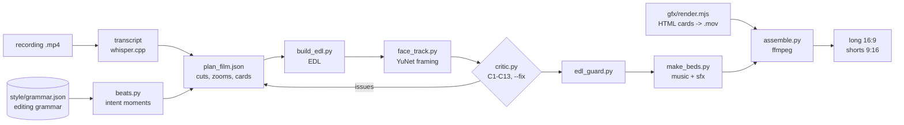

# video-pipeline

**One talking-head recording in, an edited long video (16:9) and a set of vertical shorts (9:16) out.**
A local, scriptable editing pipeline: transcript, edit plan, EDL, face-aware framing, motion cards, music beds and an
ffmpeg render, with an automatic critic between every step. The browser editor that sits on top of it lives in its own
repository: [kamiljan11/video-pipeline-panel](https://github.com/kamiljan11/video-pipeline-panel).

Built for the author's own channel. Code under the [MIT licence](LICENSE); the author's photo (`gfx/test_kw.jpg`), name and
brand are not part of that grant.



## What it does

| Stage | Script | Notes |
|---|---|---|
| Transcript | `chunked_whisper.py` | whisper.cpp large-v3 (q5), word timings; `transcribe.py` = faster-whisper fallback |
| Edit moments | `beats.py`, `beatfx.py` | hooks, numbers, contrasts, punchlines, lists, questions -> zooms, cards, cuts, by the rules in `style/grammar.json` |
| Edit decision list | `build_edl.py`, `edges.py` | cuts on word boundaries, dead-air trimming, cut-edge repair (`edge_fix`) |
| Framing | `face_track.py`, `head_check.py` | face tracking for 16:9 and 9:16 crops, zoom limits that keep the head in frame |
| Critic | `critic.py` | 13 checks: static stretches, overlay collisions, hook timing, choppy shots, caption length, end screen, loudness (-14 LUFS), clipped speech, unverified numbers on screen, editing grammar, b-roll, dead air and loud cuts at edges; `--fix` rewrites the plan |
| Safety | `edl_guard.py` | an EDL may carry only numbers, local paths and allow-listed filters into ffmpeg ([ADR-0006](docs/adr/0006-edl-guard.md)) |
| Motion cards | `gfx/render.mjs` | HTML/CSS cards (keywords, numbers, maxims, web pages, lists) rendered by Chrome to ProRes 4444 with alpha |
| Text behind the speaker | `behind.py` | RobustVideoMatting matte, the card sits between the background and the person ([ADR-0005](docs/adr/0005-text-behind-speaker.md)) |
| B-roll | `broll.py`, `stock.py` | free Pexels clips where the speech names a concrete thing; credits for the description |
| Music | `music/make_beds.py` | generated beds and SFX, ducked under the voice |
| Render | `assemble.py`, `run_v4.sh` | segment cache, grading, captions for shorts, final mix; `--proxy` for 360p previews |
| Viewer review | `viewer_pack.py`, `review/viewer.md` | frame sheets + what is said + what is on screen, for an agent acting as a first-time viewer |

The editing style is data, not code: `style/grammar.json` (rules per format), `style/RESEARCH.md` (sources and lessons
from real reviews), `style/themes/` (brand colours). Decisions are recorded as ADRs in [`docs/adr/`](docs/adr/); terms
(plan, EDL, moment, critic codes, plan keys) are defined in the panel's [glossary](https://github.com/kamiljan11/video-pipeline-panel/blob/main/docs/GLOSSARY.md).

## Plan keys (sound, picture, framing)

The full table of plan keys lives in the panel repo: [README › Klucze planu](https://github.com/kamiljan11/video-pipeline-panel/blob/main/README.md).
The keys below change how the film sounds and looks; `build_edl.py` checks them when it reads the plan and `edl_guard.py`
checks the EDL again before ffmpeg runs. A bad value stops the build with the key named.

| Key | Values | Effect |
|---|---|---|
| `progress` | `"fill"`, `true`, `false` | `"fill"`: a bar at the bottom that grows with the film time. `true`: the old `drawbox` bar, which stands full width from the first frame; kept so old EDLs render the same |
| `music_duck` | `{"threshold": 0.001..1, "ratio": 1..20}` | how far the music dips under the voice (`sidechaincompress`). Default 0.015 / 6 nearly hides music under speech; 0.05 / 2.5 keeps it audible |
| `music_db`, `sfx_db` | dB | music and sound-effect level |
| `audio` | ffmpeg filter chain for the voice | replaces the default voice chain; only filters on the `AUDIO` list in `edl_guard.py` |
| `grade` | ffmpeg filter chain for the picture | replaces the default colour grade; only filters on the `VIDEO` list (`hqdn3d` included, against sensor grain in 9:16 crops) |
| `pads` | `{"pre", "post", "keep_l", "keep_r", "mingap"}`, seconds 0..2, each optional | more air at cuts. `pre`/`post`: sound kept before the first and after the last word of a keep (default 0.10 / 0.16); `keep_l`/`keep_r`: pause left after / before speech when a long pause inside a keep is shortened (0.15 / 0.12); `mingap`: only pauses longer than this are shortened (0.45). Absent = the defaults, old plans cut as before |
| `face_target_y` | 0.3..0.6, vertical films only | height of the face centre in a zoomed 9:16 crop (default 0.40). Set it close to where the face sits in the recording (about 0.48 for a seated talking head), or the head jumps between zoomed and unzoomed shots. A 16:9 plan ignores it with a warning. Changing it re-cuts the segments on the next render |

## Quick start (Ubuntu)

The scripts expect the checkout at `/home/kamil-jan/video-pipeline` (the author's machine; the path is written into
`run_v4.sh`, `assemble.py`, `face_track.py`, `gfx/*.mjs` and others). Elsewhere, symlink that path to your checkout, as
CI does, or replace it (`grep -rl /home/kamil-jan`). Chrome is expected at `/usr/bin/google-chrome`. Linux only.

```bash
sudo apt install ffmpeg poppler-utils python3.12-venv   # ffmpeg 8 or newer (24.04 apt has 6.1); + Node 24, Google Chrome
npm ci
python3.12 -m venv .venv && .venv/bin/pip install -r requirements.txt
# whisper.cpp + model, YuNet face model, optional matting model: see "Postawienie od zera" below
bash run_v4.sh <project>/work <project>/out long short1
```

A project directory holds the recording, `words.json` (transcript), `plan_<film>.json` and `gfx_specs.json`; renders
and caches go to `render/` (ignored by git). Recordings, transcripts and renders are never committed.

## Install with Claude Code

The pipeline is a Linux tool (developed on Ubuntu 26.04). Nobody has installed it on another machine yet, so expect a
few fixes. The quickest route is to let an AI coding agent do the setup on your machine: open
[Claude Code](https://claude.com/claude-code) in an empty directory and paste the prompt below. On Windows, run it
inside WSL2 (Ubuntu); native Windows is not supported.

```text
Install the video pipeline from https://github.com/kamiljan11/video-pipeline on this Linux machine and make it run
from where you clone it.

1. Read README.md first: "Quick start", "Postawienie od zera (Ubuntu)" (Polish, the full setup) and the table of
   scripts. requirements.txt and package-lock.json pin the versions; install exactly those.
2. The scripts contain the author's path /home/kamil-jan/video-pipeline (find them with
   `grep -rl /home/kamil-jan --include=*.py --include=*.sh --include=*.mjs .`). Replace it with this checkout's path,
   or create that path as a symlink if I agree to it. Chrome is expected at /usr/bin/google-chrome.
3. Install the system packages: ffmpeg 8 or newer (Ubuntu 24.04 apt has 6.1, too old; CI uses a static 8.x build),
   poppler-utils, Python 3.12 venv, Node 24, Google Chrome, ruff (`pipx install ruff==0.16.10`, the version CI uses). Then whisper.cpp at
   the commit named in the README with the large-v3-q5_0 model, and the YuNet face model. Show me each command that
   needs sudo before running it.
4. Run the tests (`npm test`, `.venv/bin/python -m unittest discover -s tests`, `ruff check .`) and fix only what
   blocks them on this machine. Tell me what you changed.
5. B-roll needs a free Pexels API key in the environment variable `PEXELS_API_KEY` (`stock.py`); ask me for it, never
   write it into a file in the repo.
6. Then take my recording <path to my .mp4>: transcribe it, propose plan_long.json (cuts, zooms, cards) and one short,
   show me the plan before rendering, render a 360p proxy (`--proxy`), and only after my OK the full render.
```

## Tests

```bash
npm test                                              # cards (node --test; needs Chrome)
.venv/bin/python -m unittest discover -s tests
ruff check .
```

The larger suite (compatibility of every script with its pre-panel baseline, live player, HTTP API) is in the
[video-pipeline-panel](https://github.com/kamiljan11/video-pipeline-panel) repository; it expects this repo as its parent directory.

---

## Dokumentacja (PL)

Operational notes below are in Polish, the working language of the project.

Skrypty montażu nagrań (talking head -> long 16:9 + shorty 9:16). Repo gita, publiczne na GitHubie od 2026-10-24 (ADR: `docs/adr/0007-*`, wcześniej `docs/adr/0001-*`, karta `web`: `docs/adr/0002-*`).

| Krok | Skrypt | Uruchamia |
|---|---|---|
| wygładzenie (szarpanie) | `dejudder.py <nagranie.mp4> <work>/<nagranie>.dejudder.mp4` (`.venv`): klatki, których kamera nie dała (ffmpeg je powtórzył), zastępuje klatką pośrednią z przepływu optycznego; czas i dźwięk bez zmian, więc plan i transkrypcja pasują; `--scan` tylko liczy. Plan: `"src"` = plik `.dejudder.mp4`. Kiedy: nagrywarka pisze w powiadomieniu „Kamera nie nadążyła” albo log `camera frames … repeated` > 2 % | ręcznie / zadanie (przed EDL) |
| transkrypcja | `chunked_whisper.py` (whisper.cpp; `transcribe.py` = to samo na faster-whisper, zapasowo) | ręcznie / zadanie |
| momenty montażu | `beats.py`, `beatfx.py` (reguły: `style/grammar.json`, źródła: `style/RESEARCH.md`) | panel „Rozpoznaj momenty” |
| b-roll stock | `broll.py` (dobór), `stock.py` (Pexels, klucz `Pexels` z Infisicala) | panel „Dobierz b-roll” |
| EDL | `build_edl.py` (krawędzie cięć: `edges.py`, klucz `edge_fix`; **nowy plan = `"edge_fix": {"dips": true}`**, opis: `panel/README.md` › Klucze planu) -> `face_track.py` | panel / `run_v4.sh` |
| krytyk | `critic.py` (C1–C13), `head_check.py` | panel / `run_v4.sh` |
| muzyka | `music/make_beds.py` | `run_v4.sh` |
| render | `edl_guard.py` (co EDL może wnieść do ffmpeg, ADR-0006; odmowa = `FAILED edl_guard <film>`), `assemble.py` (`--proxy` = podgląd), grafiki `gfx/render.mjs` | `run_v4.sh <work> <out> <filmy…>` |
| recenzent-widz | `viewer_pack.py <plan.json> <film.mp4> <katalog>` (`.venv`): arkusze klatek co 2,5 s (short 1,5 s) z czasem + co mówi + co na ekranie, okna 30 s (short 15 s) -> `pack.md`; agent czyta to wg `review/viewer.md` i zapisuje `findings.<film>.json` (gdzie widz odpadnie: nuda, pusta karta, niezgodność obrazu i słów). Uwagi nanosi człowiek albo sesja główna | po renderze, przed publikacją (sesja Claude Code) |

Panel montażowy i cała dokumentacja (README z obsługą błędów, kluczami planu i kontraktami skryptów, słownik, ADR gramatyki
montażu i b-rollu, testy tych skryptów): `panel/` — osobne repo gita (tu ignorowane), zob. `panel/README.md`,
`panel/docs/GLOSSARY.md`, `panel/docs/adr/`.

Logi (`render/`): `render.log` (każdy krok, `DONE <film>` / `FAILED <krok> <film>` / `FAILED_FILMS`), `critic_<film>.log`,
`beat_stats.log` (metryka po renderze), `gfx.log` w katalogu `work` projektu.

Jednorazowe skrypty projektu 2026-10-20 (sztywne ścieżki, nie do nowych projektów): `render_v3.sh`, `render_all.sh`,
`check_long.sh`, `final_check.sh`. Pomocnicze: `run_whisper.sh` (whisper.cpp bez dzielenia), `spot_check.py`, `verify_cut.py`,
`lines.py`, `to_otio.py` (eksport long do Kdenlive, woła go `run_v4.sh`), `stop_render.py`, `pdl.sh` (pobieranie równoległe),
`music/gen_music.py`. `PANEL_SPEC.md` / `PROMPT_PANEL.md` = historyczna specyfikacja panelu (aktualna: `panel/README.md`).

## Postawienie od zera (Ubuntu)
Ścieżka `/home/kamil-jan` jest wpisana w wielu skryptach (m.in. `run_v4.sh`, `assemble.py`, `face_track.py`, `head_check.py`,
`chunked_whisper.py`, `gfx/*.mjs`): na innym koncie/komputerze najpierw znajdź wszystkie (`grep -rl /home/kamil-jan --include=*.py
--include=*.sh --include=*.mjs . | grep -v -e node_modules -e whisper.cpp -e panel/`).
1. System: `ffmpeg` 8 lub nowszy (apt w Ubuntu 24.04 ma 6.1), `python3` (systemowy: build_edl, critic, assemble, beats, beatfx, broll, stock), Node 24, Google Chrome w
   `/usr/bin/google-chrome` (plansze renderuje `playwright-core` na tym Chrome), `poppler-utils` (karty `web` z PDF). `.venv`: face_track, head_check, make_beds, to_otio.
2. `npm ci` (playwright-core, lucide-static, gsap z `package-lock.json`; gsap tylko dla kart `count`).
3. `python3.12 -m venv .venv && .venv/bin/pip install -r requirements.txt` (wersje przypięte, stan 2026-10-21).
4. whisper.cpp: `git clone https://github.com/ggml-org/whisper.cpp && cmake -B whisper.cpp/build -S whisper.cpp &&
   git -C whisper.cpp checkout 231638a && cmake --build whisper.cpp/build -j` (231638a = wersja używana od 2026-10); model: `whisper.cpp/models/download-ggml-model.sh large-v3-q5_0`, plik do
   `models/ggml-large-v3-q5_0.bin`.
5. `models/face_detection_yunet_2023mar.onnx`: detektor twarzy YuNet z https://github.com/opencv/opencv_zoo
   (`models/face_detection_yunet/`, plik przez Git LFS); sha256 lokalnej kopii zaczyna się od `8f2383e4dd3cfbb4`.
6. B-roll: klucz API Pexels w zmiennej `PEXELS_API_KEY` (albo `Pexels`; u autora sekret `Pexels` w Infisicalu, most `~/infisical`);
   bez niego reszta pipeline'u działa.
7. Panel: `panel/` = osobne repo https://github.com/kamiljan11/video-pipeline-panel sklonowane do `panel/` (`panel/README.md`).
8. Lint/typy (globalnie, nie w `.venv`): `pipx install ruff==0.16.10` (wersja z CI), `npm i -g pyright`.
9. Tekst za postacią (tylko gdy plan ma karty `"behind"`): `python3 -m venv matte/.venv && matte/.venv/bin/pip install -r matte/requirements.txt`
   + model `matte/models/rvm_resnet50_fp32.onnx` z https://github.com/PeterL1n/RobustVideoMatting/releases/tag/v1.0.0
   (sha256 `25db300fcb6ee27f…`, `behind.py` sprawdza go przy każdym uruchomieniu; decyzja: ADR-0005).

Przed publikacją shorta z b-rollem: linie autorów do opisu filmu (wytyczne API Pexels) = okno „Dobierz b-roll” w panelu albo
`python3 broll.py plan_<film>.json --credits` w katalogu `work`.

Bramki: pre-commit (ruff, pyright, skan sekretów) działa przez globalne `core.hooksPath=~/.claude/git-hooks` laptopa, nie z repo;
na innej maszynie uruchamiaj `ruff check . && pyright` ręcznie.
**Kopia kodu i zasad stylu:** publiczne repo https://github.com/kamiljan11/video-pipeline (+ panel: kamiljan11/video-pipeline-panel),
od 2026-10-24 (ADR-0007). Nagrania, transkrypcje, plany i rendery NIE idą do gita (`.gitignore`): kopii poza laptopem nie mają.
**Dysk:** od 2026-10-24 `~/video-pipeline` i `~/Videos` to symlinki do `~/Dane/...` (dysk Dane, LUKS, montowany przy starcie z
`/etc/crypttab`); ścieżki w skryptach i planach się nie zmieniły. Panel kluczuje swoje katalogi po ścieżce rozwiązanej (`render/panel/*/<klucz>`).

Testy skryptów: `cd panel && .venv/bin/python -m unittest discover -s tests` (strażnik zgodności: bez nowych kluczy planu
wynik identyczny jak `panel/tests/pipeline_baseline/*.py.orig`). Lint: `ruff check .`, `pyright` (pre-commit).
Testy `dejudder.py` i `viewer_pack.py`: `.venv/bin/python -m unittest tests.test_dejudder tests.test_viewer_pack`.
Testy kart `web` i `count` (JS, bez internetu; `count` renderuje w Chrome): `npm test`; uruchamia je też zestaw panelu (`panel/tests/test_gfx_node.py`).

Dodanie dostawcy stocku: funkcja wyszukiwania w `stock.PROVIDERS` + host plików w `stock.HOSTS` + klucz w Infisicalu
(most `~/infisical/infisical_bridge.py run --secrets <NAZWA> --`), potem `"provider"` w `style/grammar.json › broll`.

## Karta źródła `web` (strona albo PDF, o którym mówisz)
Dlaczego zrzut z animacją, a nie nagranie ekranu, i jak chroniona jest sieć: `docs/adr/0002-web-source-card.md`.
Gdy w nagraniu przytaczasz badanie, artykuł albo stronę, pokaż ją: karta = okno przeglądarki ze stroną, przewija się do
cytowanego zdania i zaznacza je markerem; twarz w rogu (jak `slide`), pod spodem „Źródło: domena · tytuł · stan na <data zrzutu>”.
Wpis w `gfx_specs.json` (kotwica w planie jak każda grafika, `"gfx": [{"id": "w_mit", "word": 512}]`):
```json
{"id": "w_mit", "type": "web", "dur": 7, "url": "https://…", "find": "dokładne zdanie ze strony (min. 8 liter)"}
```
- PDF: ten sam wpis (adres PDF); opcjonalnie `"page": 3`, gdy zdanie występuje na kilku stronach. Podpis własny: `"src"`.
- Strona blokuje roboty (captcha, logowanie, paywall): zrób zrzut sam, połóż w katalogu `work` projektu i daj
  `{"id": …, "type": "web", "dur": 7, "img": "zrzut.png", "box": [x, y, szer, wys], "url": "…", "title": "…"}` (`box` w pikselach zrzutu).
  Blokad nie obchodzimy. W panelu: pole „własny zrzut” w edytorze grafiki (`box` tylko w pliku).
- Zrzut robi `gfx/webshot.mjs` (woła go `gfx/render.mjs` sam): Chrome 1200 px szerokości, tylko `https://` i tylko publiczne
  adresy: każde połączenie (też przekierowania, skrypty i obrazki strony) jest sprawdzane PO rozwiązaniu nazwy przez
  `gfx/netguard.mjs` (Chrome idzie przez jego lokalny proxy), więc nazwa wskazująca na `127.0.0.1`, sieć domową (też publiczny prefiks IPv6 laptopa) albo Tailscale
  (np. `127.0.0.1.nip.io`) jest odrzucana; `file://` też. Chrome ze stroną działa w piaskownicy. `img` = sama nazwa pliku. Banery cookies są ukrywane, nigdy klikane. Zrzut jest robiony raz:
  `work/gfx/web/<klucz>.png/.json` (klucz = `url`, `find`, `page`, `img` z treścią pliku, `box`, `title`); zmiana któregoś
  z nich = nowy zrzut i nowy `.mov` karty. Ten sam adres od nowa (strona się zmieniła): usuń te dwa pliki.
- Błąd (zdania nie ma na stronie, HTTP 4xx/5xx, adres prywatny, > 150 s na kartę) = `FAILED webshot <id>: powód` w `gfx.log`
  (render z `run_v4.sh`) albo w wyniku zadania w panelu (podgląd), i film się nie renderuje (`FAILED gfx`). Nieudany zrzut nie
  zostaje w pamięci: po poprawce wystarczy uruchomić ponownie. Karta jest tylko do filmu 16:9 (shorty: później).
- Prawo cytatu: krótki fragment z podanym źródłem; nie pokazuj całych artykułów zza paywalla.

## Karta licznika `count` (liczba odliczana od 0)
Decyzja i koszt: `docs/adr/0003-gsap-count-card.md`. Wygląd jak `kw` (ta sama ramka, `side`, `icon`, `canvas: "v"` + `compact`),
ale każda liczba z `text` odlicza od 0 do swojej wartości (GSAP, `gfx/count_lib.mjs`). Bez nowych pól:
```json
{"id": "c95", "type": "count", "text": "95%", "sub": "firm bez zwrotu z AI", "dur": 4}
```
- Liczy: „95%”, „2,5 dnia” (przecinek), „12 000 zł” (spacja tysięcy zostaje), „50–70%” (obie liczby), „-5%” (minus zostaje tekstem).
- Nie liczy (zostaje jak napisane): liczby w słowie albo kodzie („B2B”, „Q3”, „v2.0”), godziny („15:30”), liczby z kropką
  („10.5”), zera wiodące („007”). Panel odrzuca kartę `count`, w której nie ma żadnej liczby do odliczania.
- Odliczanie startuje po 0,35 s (gdy ramka już weszła) i trwa 40 % długości karty, maks. 1,6 s; kończy się przed wygaszeniem.
  Karta krótsza niż ok. 1 s pokazuje liczby od razu.
- Dźwięk „pop” jak `kw`; pod kartą 16:9 nie ma najazdu (`gfx_types.SIDE_BOX`).
- Wymaga `node_modules/gsap` (`npm ci`, krok 2 wyżej). Bez niego render kart kończy się `FAILED gfx` w `render.log`.

## Złota myśl `maxim` (zdanie pisane na ekranie)
Puenta, którą chcemy podkreślić: zdanie pisze się litera po literze z kursorem, w chwili gdy pada; słowa w `*gwiazdkach*`
dostają kolor akcentu i kreskę markera po napisaniu. 16:9: dolny pas z ciemnym gradientem (twarz zostaje widoczna, najazd
pod kartą działa); `canvas: "v"`: górny pas shortu. Logika: `gfx/maxim_lib.mjs`, test: `gfx/test/maxim.test.mjs`. Bez GSAP.
```json
{"id": "m01", "type": "maxim", "text": "Prawdziwy ból jest *cichy*", "dur": 5, "at": [0.2, 0.85, 2.6, 2.87],
 "sfx": [[3.0, "pop"]]}
```
- `at` (opcjonalne): start każdego słowa napisu w sekundach od startu karty, z transkrypcji (tyle liczb, ile słów; inaczej
  równe tempo po literach). Czas nigdy nie cofa się i nie wychodzi poza kartę: ostatnie słowo widać min. 0,3 s. Napis nie
  musi być dosłowny, ale każde jego słowo przypinamy do słowa, które wtedy pada.
- Litera pojawia się najwyżej co 0,045 s i słowo kończy się przed następnym; kursor gaśnie 0,7 s po ostatniej literze.
- Dźwięk: miękki whoosh na wejście (`make_beds.py`); własne chwile karty (np. pop na wyróżnieniu) w `sfx`.
- Kiedy: 1 zdanie-puenta (`maxim` w gramatyce), maks. ok. 1 na 3–4 min w long; nie razem z inną kartą.

## Tekst za postacią (`"behind"` w karcie)
Duże słowo ZA głową mówiącego (głowa zasłania środek napisu). Karta dowolnego typu (zwykle `float` z własnym html) dostaje
`"behind": {"edl": "edl_long.json"}`; `behind.py` wycina z jej kanału alfa postać, wyliczoną modelem Robust Video Matting na
klatkach filmu POD kartą (nagranie cięte i kadrowane jak w `assemble.py`, którego `vf_for` czyta). Wynik zastępuje `<id>.mov`
(oryginał: `<id>.front.mov`), więc `assemble.py` i odtwarzacz panelu po prostu nakładają kartę.
```json
{"id": "b02_bol", "type": "float", "dur": 3.2, "html": "<div class=\"bw\" style=\"top:170px;font-size:380px\">BÓL</div>",
 "behind": {"edl": "edl_long.json"}}
```
- Uruchamiają go `gfx/render.mjs` (po renderze kart; EDL jeszcze niezbudowany albo niepasujący do karty = komunikat „left for run_v4.sh”, reszta grafik idzie dalej;
  błąd samej karty, np. zły `ratio`, = FAILED) i `run_v4.sh` (przed `assemble.py`,
  `--edl edl_<film>.json`: karty tego filmu na jego EDL po poprawkach krytyka). Przetworzona karta ma w metadanych klucz
  (`comment=behind:…`); ten sam klucz = pominięta, `.mov` bez znacznika = świeży render (nowy `<id>.front.mov`).
- Plan musi mieć `"seg_exact": true`; karta do 20 s, w rozmiarze klatki filmu (najwyżej 4K); `id` i nazwa EDL tylko
  `[A-Za-z0-9_-]`. Opcja `"ratio"` (większa od 0, najwyżej 1; domyślnie 0.2) = skala, w jakiej model patrzy na klatkę (mniejsza = szybciej, grubsza maska).
- Efekt wyłączasz, usuwając `"behind"` ze speca i przesuwając `<id>.mov` i `<id>.front.mov` na bok (render.mjs zrobi zwykłą kartę). Maska myli się
  na dłoni przed głową: wtedy inne miejsce na słowo.
- Napis musi sięgać głowy (dół słowa na wysokości czubka głowy lub niżej), inaczej efektu nie widać. `build_edl` trzyma kadr
  pod kartą nieruchomo. Zmiana kadrowania w `assemble.py` (`vf_for`) wycina karty od nowa.
- Instalacja: „Postawienie od zera” pkt 9. Ok. 0,1 s na klatkę 2560x1440 na CPU (wątki z `cpu_budget.py`, nice 10).
- Testy: `matte/.venv/bin/python -m unittest matte/test_behind.py` (też w zestawie panelu: `panel/tests/test_behind.py`).

## Motyw (kolory kart, napisów i ramki PiP)
Kolory są danymi, nie kodem: `work/theme.json` `{"theme": "cetus"}` wybiera `style/themes/cetus.json`. Bez `theme.json` wszystko
zostaje jak było (kolory z `gfx/template.html`, bit w bit).
- `style/themes/<nazwa>.json` → `"css"`: tokeny `--acc`, `--ink`, `--acc-rgb`, `--bg-a`… nadpisują `:root` z
  `gfx/template.html` (pełna lista tam). Wartość: `#hex`, `r,g,b` albo prosta funkcja koloru; nic innego nie przejdzie.
- Karty (`gfx/render.mjs`, logika `gfx/theme_lib.mjs`): po zmianie albo usunięciu motywu każda karta renderuje się od nowa
  (stempel `<id>.mov.key`). Własne kolory w HTML slajdu w `gfx_specs.json` pisz jako `var(--acc)`, `rgba(var(--acc-rgb),.4)`.
- Napisy i pasek postępu (`themes.py`): `--acc` = podświetlone słowo i pasek, `--ink` = tło haczyka (pełny box: w ASS BorderStyle 3 kolor boxa to OutlineColour; do 2026-10-24 motyw wpisywał go w
  BackColour, który libass tu pomija, więc hak wychodził czarny — shorty renderowane przed `1b378af` mają czarny hak); oba muszą być `#RRGGBB`.
- Ramka PiP: `node gfx/pip_assets.mjs <SIZE> <#RRGGBB> <nazwa>` → `gfx/pip_frame_<nazwa>_<RRGGBB>.png` (akcent w nazwie: po
  zmianie `--acc` assemble.py przerywa z gotową komendą zamiast użyć starej ramki). Test: `gfx/test/theme.test.mjs`, `tests/test_themes.py`.
- Nowy motyw = plik w `style/themes/` + ramka PiP (komenda wyżej), kod się nie zmienia. Decyzja i koszt: `docs/adr/0004-theme-as-data.md`.
- Font zostaje Montserrat także w motywie Cetus (Poppins z marki = osobna decyzja: instalacja fontu, weryfikacja źródła).
  Pojęcia pipeline'u i panelu (motyw, krawędź ujęcia, złota myśl…): `panel/docs/GLOSSARY.md`.

## Ekran końcowy shorta (`end` + `canvas: "v"`)
Po ostatnim zdaniu shorta 3 s planszy „gdzie pełny odcinek” + pigułka „Subskrybuj @kamiljan11” (kolory z motywu, whoosh z
`make_beds.py`). Plan shorta: `"tail": 3` i w `gfx` `{"id": "v_end", "word": "END"}` (start = koniec mowy); bez `tail` short
kończy się na ostatnim słowie jak dotąd (test: `panel/tests/test_pipeline_compat.py`). Tekst w `gfx_specs.json`:
```json
{"id": "v_end", "type": "end", "canvas": "v", "text": "Pełny odcinek na kanale", "sub": "Subskrybuj @kamiljan11", "dur": 3}
```
**Logo firmy na planszy końcowej** (każda karta `end`, 16:9 i 9:16): `"logo"` = plik obrazu (ścieżka względem `gfx_specs.json`,
np. `brand/…png`, logo jasne pod ciemne `--end-bg`), `"logo_sub"` = linia pod nim (np. strona firmy). Logo 96 px wysokości
(9:16: 64 px), wchodzi po adresie. Brak pliku albo obraz, który się nie wczyta = `FAILED gfx <id>: …` i render stoi (nigdy plansza
z pustym obrazkiem; render czeka na wczytanie obrazów każdej karty, także `web`). Stempel `.mov` karty z logo = spec + bajty pliku
logo: nowe logo pod tą samą nazwą albo zmiana `logo`/`logo_sub` renderuje planszę od nowa sama. Test: `gfx/test/end.test.mjs`.
```json
{"id": "g19_end", "type": "end", "text": "Dzięki za obejrzenie", "sub": "KamilJan.com", "logo": "brand/cetus-automation-light-x4.png", "logo_sub": "automation.cetuspro.com", "dur": 10.7}
```

## Hak shorta w pigułce i napisy w boxie (styl shortów, `render/montaz/2026-10-22/STYL-SHORTOW.md` R1–R3)
- **Hak = karta, nie napis u góry:** `maxim` z `"canvas": "v", "pill": true` to półprzezroczysta biała pigułka (66 % krycia, twarz prześwituje) w strefie napisów (dolna krawędź 400 px nad dołem kadru, pod brodą),
  zdanie pisane literami, słowa w `*gwiazdkach*` w `--acc-dim` (kontrast na bieli). W planie: `{"id": "v_hook1", "word": 0}`
  zamiast `hook_text`; `dur` ~3–3.5 s.
  ```json
  {"id": "v_hook1", "type": "maxim", "canvas": "v", "pill": true, "text": "*95%* firm nie widzi zwrotu z AI", "dur": 3.5}
  ```
- **Napisy pauzują pod pigułką** (R3): linia ASS, która zaczyna się w oknie karty z `pill`, wchodzi dopiero w chwili zejścia
  pigułki, jeśli zostaje jej co najmniej `PILL_MIN_LEFT` = 0,3 s (krócej = pominięta; bez tego po zejściu pigułki była klatka
  bez napisu, choć mówi — przegląd widza 2026-10-24, short2/short4). Linię sprzed karty ucina na jej starcie. Bez kart `pill`
  napisy jak dotąd. Szybkie pisanie haka: `at` w specu (np. słowa w 0,1–0,8 s), żeby pełne hasło stało ≥ 2,5 s.
- **`"caption_box": true`** w planie shorta (R2): napisy w pełnym boxie w kolorze `--ink` motywu (bez motywu czarny), 80 px,
  środek ~64 % wysokości (pod brodą) zamiast gołego tekstu z obrysem na ~72 %. Box nieprzezroczysty: libass rysuje box osobno
  dla każdego kawałka koloru, półprzezroczyste nachodzą na siebie ciemnymi pasami. Bez klucza = stare napisy (test bit w bit).
- **Ręczne `"pill": true` na karcie, która ma już `.mov`:** `gfx/render.mjs` nie renderuje jej ponownie (stary wygląd u góry, a napisy
  i tak pauzują). Odsuń `gfx/<id>.mov` albo dodaj nową kartę (nowe `id`); panel odsuwa stary `.mov` sam.
- **Wymiary pigułki i boxa są w kodzie** (`gfx/template.html`, styl `Cap` w `build_edl.py`), nie w danych: jedna seria, jeden styl
  (STYL-SHORTOW R10); osobny plik stylu dopiero, gdy pojawi się drugi wygląd.
- **`pill` tylko na `maxim` z `canvas: "v"`** (CSS istnieje tylko tam): inaczej `build_edl.py` i panel stopują z nazwanym błędem.
- **Świadomie inaczej niż STYL-SHORTOW:** bez emoji/ikony na końcu pigułki i bez push-inu przy jej zejściu (R1); hak wpisuje człowiek
  w planie, nie `beats.py` (`hook`); napisy pauzują tylko pod `pill`, karty `kw`/`list`/`cta` 9:16 stoją w górnym pasie, więc nie
  kolidują (R3); napisy zostają WIELKIMI literami w całości (R2: „CAPS tylko na słowach kluczowych” = osobna zmiana).
- **Brak metryki:** STYL-SHORTOW opiera się na 6 starych shortach Kamila, a ich oglądalność nie dowodzi, że styl działa. Ocena:
  porównać retencję pierwszych 3 s w YouTube Studio między shortami z `hook_text` (2026-10-23) a z pigułką.

## Gdzie są shorty w longu (`shorts.py`)
`python3 shorts.py plan_long.json [--n 5] [--min 25] [--max 60] [--json kandydaci.json]` (w katalogu `work`): ranking ciągów
całych zdań longa trwających min–max s, które nie nachodzą na siebie, z powodem przy każdym wyniku. Plusy: hak w 1. zdaniu
(liczba, pytanie, kontrast, wyznanie, puenta), puenta na końcu, konkrety w środku, długość ~42 s. Minusy: start, który
nawiązuje do wcześniej („Czyli…”, „Po drugie…”, „Ale…”, w pół zdania), koniec pytaniem / w pół zdania / zapowiedzią dalszej
części, CTA longa w środku. Momenty z tych samych reguł co `beats.py` (`style/grammar.json`). `--json` daje `keeps` gotowe do
`plan_short*.json`; wybór i tekst haka zostają człowiekowi (albo sesji Claude). Narzędzie tylko czyta. Test: `tests/test_shorts.py`.
Shorty z kilku kawałków (cięcia w środku) to dalej praca ręczna: narzędzie szuka ciągłych fragmentów.
`--n` to limit listy, nie reguła „ile shortów”: bierzemy tylu kandydatów, ilu ma wynik > 0 i sens bez kontekstu. Brak metryki:
ranking sprawdzony raz ręcznie (long 2026-10-22: 4 z 5 ręcznie wybranych shortów pokrywa się z top 6); wagi w `shorts.py` do
strojenia na kolejnych longach. Długość = czas mowy (pauzy między zdaniami nie liczą się).
