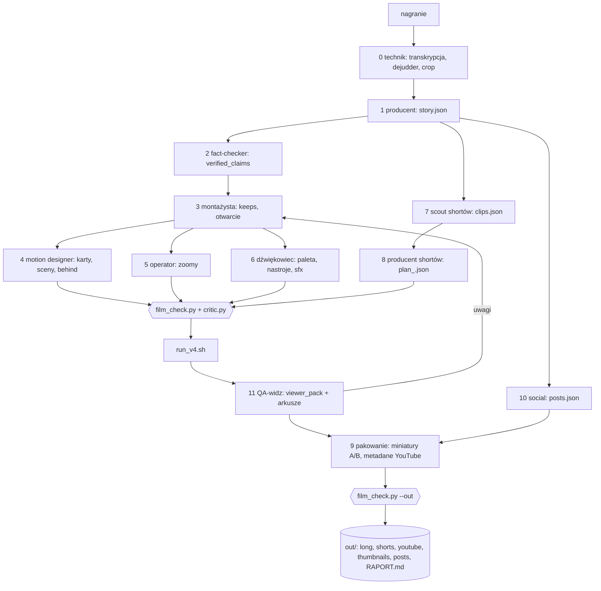

# Zespół montażowy: jak z jednego nagrania powstaje long, shorty, posty i pakiet publikacji

Jedno nagranie -> jeden folder `out/`. Każda rola to karta w `team/roles/`: misja, wejście, artefakt, rubryka z liczbami, „gotowe gdy”.
Rolę gra sesja Claude Code albo subagent (świeży kontekst, czyta tylko swoją kartę i artefakty wejściowe). Między etapami stoją
bramki 0-tokenowe (skrypty). Nic nie idzie dalej, dopóki bramka nie jest zielona. Dlaczego tak: film 2026-11-04 zgubił połowę
funkcji, bo plan powstał „z pamięci” jednej sesji (`docs/designs/2026-11-04-editorial-team.md`).

## Kolejność i bramki

| # | Rola (karta) | Wejście | Artefakt w `work/` | Bramka |
|---|---|---|---|---|
| 0 | `technik.md` | nagranie | `*.cw.json`, `*.sil`, `*.wav`, `*.crop.mp4` | pliki istnieją, długość = nagranie |
| 1 | `producent.md` | transkrypt (`*.lines.txt`) | `story.json` | `film_check` long.story |
| 2 | `fact-checker.md` | story, transkrypt | `verified_claims` w planach | `critic.py` C9 |
| 3 | `montazysta.md` | story | `keeps`, kolejność, otwarcie w `plan_long.json` | `build_edl.py`, `verify_cut.py`, critic C8/C13 |
| 4 | `motion-designer.md` | story, plan, słowa | `gfx_specs.json` + `gfx` w planach | `film_check` (rozdziały, objaśnienia, gęstość, behind) |
| 5 | `operator.md` | plan, story | `emph` w planach | `film_check` punch |
| 6 | `dzwiekowiec.md` | story | `music_palette`, `music_moods`, `sfx_style`, `sfx` w kartach | `film_check` music |
| 7 | `scout-shortow.md` | transkrypt, story | `clips.json` (wszyscy kandydaci, ocena, `make`) | każdy kandydat oceniony |
| 8 | `producent-shortow.md` | clips.json | `plan_<clip>.json` dla każdego `make: true` | `film_check` short.* |
| 9 | `pakowanie.md` | story, EDL po renderze | `thumbs.json`, `out/youtube/*.md`, `out/thumbnails/` | `film_check --out` |
| 10 | `social.md` | story, clips | `posts.json`, `out/posts/<id>/` | `film_check --out` posts |
| 11 | `qa-widz.md` | out/ | `qa/findings.<film>.json`, poprawki | brak blockerów |

Uruchomienie renderu: `bash run_v4.sh <work> <out>/_render long <clipy…>` (run_v4 sam woła `film_check` przed renderem), potem
rozłożenie do `out/long/`, `out/shorts/` i `python3 film_check.py <work> --out <out>`.
Render stoi (`FAILED scene_check`, `FAILED gfx`, `FAILED film_check <film>` w `render/render.log`): tabela „Bramki w
`run_v4.sh` i co robić, gdy render stoi” w `README.md` (gdzie przyczyna: `gfx.log`, `critic_<film>.log`; wyłączniki
`SCENE_CHECK=off` / `FILM_CHECK=off` tylko z powodem, zostawiają `WARN` w logu).

## Zasady dla każdej roli
- Liczby z rubryk pochodzą z `render/ref/research/*.md` (rozbiory filmów, tutoriale, research). Inny próg = zmiana w
  `style/checklist.json` z powodem, nie decyzja w głowie.
- Pominięcie pozycji listy kontrolnej tylko z powodem w planie (`"skip": {"long.behind": "powód"}`).
- Rola nie poprawia artefaktów innej roli; uwagi zapisuje w swoim artefakcie (`notes`), sesja główna rozstrzyga.
- Ilość z jakości: shortów i postów jest tyle, ilu kandydatów przeszło próg w rubryce, nie stała liczba.
- Nic nie jest publikowane. Wynik to folder `out/` do obejrzenia przez Kamila (memory: watch locally).
